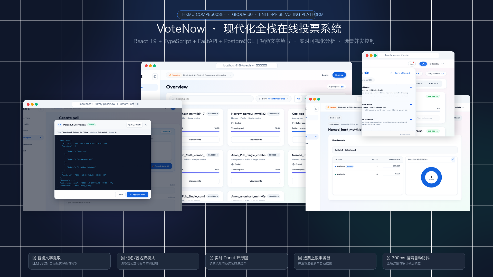
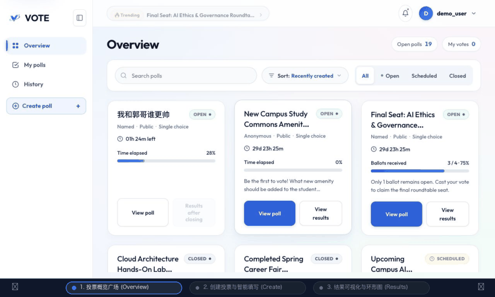
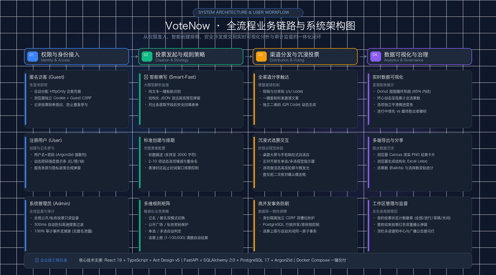

# VoteNow · Online Voting and Election System

* [中文](README.md) | **English**

* VoteNow is a course project by Group 60 for HKMU COMP8500SEF. It uses a React frontend and a separate Python backend. It supports everyday polls and course-demonstration elections with voter registration, eligibility review, roster freezing, and secret ballots.

  Registered users can create polls. Guests can participate directly in public anonymous polls, while private polls require a share link and an access password. The project supports Docker Compose deployment and separate frontend and backend development.

## System Showcase & UI Previews

* Full-stack modern online voting platform architecture & core views showcase:

  

* Core UI interactive switcher (click navigation buttons `| Previous | 1, 2, 3 | Next |` below, or try the [interactive web viewer](docs/images/interactive-viewer.html)):

<a id="preview-1"></a>

| [◀ Previous](#preview-3) | **[ 1 ] Overview** | [[ 2 ] Create Poll](#preview-2) | [[ 3 ] Results](#preview-3) | [Next ▶](#preview-2) |
| :---: | :---: | :---: | :---: | :---: |

> **Screen 1 / 3 · Overview Plaza**: Browse poll status, remaining time, responsive grid, and ballot progress.


<br/>

---

<a id="preview-2"></a>

| [◀ Previous](#preview-1) | [[ 1 ] Overview](#preview-1) | **[ 2 ] Create Poll** | [[ 3 ] Results](#preview-3) | [Next ▶](#preview-3) |
| :---: | :---: | :---: | :---: | :---: |

> **Screen 2 / 3 · Create Poll & Smart Fill**: Configure topic, options, schedule, and rules with LLM text recognition and JSON preview.


<br/>

---

<a id="preview-3"></a>

| [◀ Previous](#preview-2) | [[ 1 ] Overview](#preview-1) | [[ 2 ] Create Poll](#preview-2) | **[ 3 ] Results** | [Next ▶](#preview-1) |
| :---: | :---: | :---: | :---: | :---: |

> **Screen 3 / 3 · Results & Donut Chart**: View ballot and selection counts, Donut chart, micro-bars, and winner status.


* Dynamic animated carousel preview:

  

  Screenshots captured on October 30, 2026, using local demo data.

## Quick Start

* Docker Compose is recommended. Select the instructions for your operating system and complete each step in order. If the project or `.env` already exists, skip the corresponding clone or copy step instead of overwriting it.

### Windows

* Complete these steps in PowerShell.

  1. Install Git and Docker Desktop, enable the WSL 2 backend, and start Docker Desktop.

  2. Clone the repository and enter its root directory. If the code already exists, enter the existing directory instead.

     ```powershell
     git clone https://github.com/qinchihongye/hkmu-2026-comp8500-group60-voting.git
     Set-Location hkmu-2026-comp8500-group60-voting
     ```

  3. Confirm that Git, Docker, and Compose are available.

     ```powershell
     git --version
     docker --version
     docker compose version
     ```

  4. Copy the environment template on first setup. Skip this step when `.env` already exists.

     ```powershell
     Copy-Item .env.example .env
     ```

  5. Open `.env` and set the database password, demo account passwords, private demo poll password, `ANON_VOTER_HMAC_KEY`, and `IDENTITY_FINGERPRINT_HMAC_KEY`. Do not commit `.env`.

     ```powershell
     notepad .env
     ```

     Keep `PUBLIC_BASE_URL=http://localhost:8188`, `ALLOWED_ORIGINS=["http://localhost:8188"]`, and `COOKIE_SECURE=false` for local Docker. Database usernames, passwords, and database names in connection URLs must match the PostgreSQL settings.

  6. Build and start the database, backend, and frontend in the background.

     ```powershell
     docker compose up -d --build
     ```

  7. Check the containers. `postgres`, `backend`, and `web` should be running, and the database should pass its health check.

     ```powershell
     docker compose ps
     ```

  8. Open VoteNow. If the page is not ready, inspect the backend startup log.

     ```powershell
     Start-Process http://localhost:8188
     docker compose logs --tail=100 backend
     ```

### macOS

* Complete these steps in Terminal. Apple Silicon and Intel Macs use the same Compose commands.

  1. Install Git and Docker Desktop, then start Docker Desktop.

  2. Clone the repository and enter its root directory. If the code already exists, enter the existing directory instead.

     ```bash
     git clone https://github.com/qinchihongye/hkmu-2026-comp8500-group60-voting.git
     cd hkmu-2026-comp8500-group60-voting
     ```

  3. Confirm that Git, Docker, and Compose are available.

     ```bash
     git --version
     docker --version
     docker compose version
     ```

  4. Copy the environment template on first setup. Skip this step when `.env` already exists.

     ```bash
     cp .env.example .env
     ```

  5. Open `.env` and set the database password, demo account passwords, private demo poll password, `ANON_VOTER_HMAC_KEY`, and `IDENTITY_FINGERPRINT_HMAC_KEY`. Do not commit `.env`.

     ```bash
     open -e .env
     ```

     Keep `PUBLIC_BASE_URL=http://localhost:8188`, `ALLOWED_ORIGINS=["http://localhost:8188"]`, and `COOKIE_SECURE=false` for local Docker. Database usernames, passwords, and database names in connection URLs must match the PostgreSQL settings.

  6. Build and start the database, backend, and frontend in the background.

     ```bash
     docker compose up -d --build
     ```

  7. Check the containers. `postgres`, `backend`, and `web` should be running, and the database should pass its health check.

     ```bash
     docker compose ps
     ```

  8. Open VoteNow. If the page is not ready, inspect the backend startup log.

     ```bash
     open http://localhost:8188
     docker compose logs --tail=100 backend
     ```

### Linux

* Complete these steps in a terminal.

  1. Follow the official instructions for your distribution to install Git, Docker Engine, and the Docker Compose plugin, then start Docker.

  2. Clone the repository and enter its root directory. If the code already exists, enter the existing directory instead.

     ```bash
     git clone https://github.com/qinchihongye/hkmu-2026-comp8500-group60-voting.git
     cd hkmu-2026-comp8500-group60-voting
     ```

  3. Confirm that Git, Docker, and Compose are available.

     ```bash
     git --version
     docker --version
     docker compose version
     ```

     If Docker reports a permission error, configure the current user's Docker group according to the official Docker guide. Use `sudo docker compose` only when permitted by system policy.

  4. Copy the environment template on first setup. Skip this step when `.env` already exists.

     ```bash
     cp .env.example .env
     ```

  5. Open `.env` and set the database password, demo account passwords, private demo poll password, `ANON_VOTER_HMAC_KEY`, and `IDENTITY_FINGERPRINT_HMAC_KEY`. Do not commit `.env`.

     ```bash
     ${EDITOR:-vi} .env
     ```

     Keep `PUBLIC_BASE_URL=http://localhost:8188`, `ALLOWED_ORIGINS=["http://localhost:8188"]`, and `COOKIE_SECURE=false` for local Docker. Database usernames, passwords, and database names in connection URLs must match the PostgreSQL settings.

  6. Build and start the database, backend, and frontend in the background.

     ```bash
     docker compose up -d --build
     ```

  7. Check the containers. `postgres`, `backend`, and `web` should be running, and the database should pass its health check.

     ```bash
     docker compose ps
     ```

  8. Open [http://localhost:8188](http://localhost:8188) in a browser. If the page is not ready, inspect the backend startup log.

     ```bash
     docker compose logs --tail=100 backend
     ```

* On all three platforms, first startup applies database migrations and creates missing demo accounts. When poll initialization is enabled, it also creates missing predefined polls. A healthy database does not mean backend migrations have finished; check the backend logs if the application is not yet available.

* Demo accounts

  | Username | Purpose | Password setting |
  | --- | --- | --- |
  | `admin` | Administrator; view all polls and audit records | `DEMO_ADMIN_PASSWORD` |
  | `demo_user` | Regular creator who owns the initialized polls | `DEMO_USER_PASSWORD` |
  | `demo_voter` | Regular participant for trying named voting | `DEMO_VOTER_PASSWORD` |

  Use the passwords configured in your own `.env`. Initialization does not reset existing account passwords; changing environment variables and restarting will not update passwords already stored in the database. Private demo polls use `DEMO_POLL_PASSWORD` during initialization.

* Common maintenance commands

  ```bash
  # Stop services while retaining the database volume
  docker compose down

  # Rebuild after changing code or dependencies
  docker compose up -d --build

  # Follow backend logs
  docker compose logs -f backend
  ```

  Both the full-stack Compose setup and the standalone database setup below use host port 5432. Do not run both database services at the same time.

## Features

* Poll creation and participation

  | Feature | Description |
  | --- | --- |
  | Accounts and guests | Registration, login, and guest browsing; creating polls requires login |
  | Named / anonymous | Named polls require login; anonymous polls use browser credentials to prevent duplicate submissions |
  | Public / private | Public polls appear in the public list; private polls require a link and password |
  | Single / multiple choice | Multiple choice can be enabled with at least three valid options |
  | Ballot limit | Optional cap on total ballot submissions; reaching the cap closes the poll |
  | Scheduling | Start and end times, including a scheduled state after publication |
  | Result visibility | Creators decide whether participants can view aggregate results while voting is open |
  | Sharing | Share links, invitation text, and QR codes |
  | Creator workspace | Manage drafts, publish and close polls, and view aggregate results |
  | Voting history | Logged-in users can view their named voting records |
  | Administration | View all polls and results, and inspect audit events |
  | Smart fill (optional) | Extract a title, options, and explicitly stated settings from text; review and edit the populated form |

* Election system (B2: identity chain separated from ballot records)

  | Feature | Description |
  | --- | --- |
  | B2 data boundary | Ballot records contain no user ID, registration ID, credential ID, IP address, or User-Agent, and have no foreign-key link to the identity chain |
  | Atomic credential consumption | The ISSUED → CONSUMED transition and ballot insertion occur in one database transaction |
  | Roster freezing | Administrators explicitly freeze the roster after registration closes and issue one internal credential for every approved registration |
  | Voter registration | Supports resident identity cards, Hong Kong/Macau permits, and student IDs; full numbers are not persisted, only a keyed HMAC-SHA-256 fingerprint and suffix |
  | Course-demo review | A local format and checksum rules engine approves, rejects, or sends registrations for manual review; it does not connect to government, university, or third-party identity databases |
  | Live-result matrix | When enabled, administrators and voters who have submitted a ballot can see candidate totals; when disabled, administrators see scale statistics only while voting is open |
  | Abstention calculation | After closing, system abstentions equal the frozen eligible-voter count minus submitted ballots |
  | Submission receipt | Voters confirm one candidate and receive a random UUID receipt; it is not a cryptographically verifiable proof |

## Workflow and Voting Rules

* For detailed steps, role permissions, result exports, and troubleshooting, see the [User Guide (Chinese)](docs/technical/user-guide.md).

* End-to-End System Workflow Diagram

  

* Basic workflow

  ```mermaid
  flowchart LR
    A[01. Identity Access<br/>Guest/User/Admin] --> B[02. Poll Creation<br/>Manual Form / ✨Smart Fill]
    B --> C[03. Policy & Schedule<br/>Named/Anon · Public/Private · Cap]
    C --> D[04. Multi-Channel Share<br/>Link / Text / QR Code]
    D --> E[05. Ballot Submission<br/>Left-aligned UI · Atomic Lock]
    E --> F[06. Analytics & Audit<br/>Donut Chart · Excel · Audit Trail]
  ```

  1. **Register or log in**: Enter title, options, and schedule in Create poll, or use Smart-Fast Fill to parse raw text and preview JSON before applying.
  2. **Configure policies**: Choose named or anonymous voting, public or private visibility, ballot limit, and result visibility. Set an access password for private polls.
  3. **Save and publish**: Save a draft, review it, and publish it from the creator workspace (polls starting in the future are scheduled automatically).
  4. **Share across channels**: Share the dedicated link, invitation text, or QR code. For private polls, provide the access password.
  5. **Participate safely**: Participants vote with single/multiple selection during the window; transactions enforce concurrency and auto-closure on ballot cap.
  6. **Analyze and govern**: Review results via Donut chart and micro-bars, export Excel or PNG share cards, close early with confirmation, or audit as admin.

* Key rules

  | Rule | Current behavior |
  | --- | --- |
  | Named voting | Each account can submit once per poll; daily repeat voting is not currently supported |
  | Anonymous voting | Each browser credential can submit once per poll; clearing credentials or switching browsers may allow another submission, so strict one-person-one-vote is not guaranteed |
  | Multiple choice | Selecting multiple options still counts as one ballot and does not permit repeated submissions |
  | Ballot limit | Caps the number of ballots received, not the sum of option votes; the submission reaching the cap and poll closure occur in the same transaction |
  | Result percentages | Each option's selections are divided by the total number of selections; multiple-choice polls may have more selections than ballots |
  | Results while open | Participants may open aggregate results; this does not imply continuous automatic refresh |
  | Creators and administrators | View aggregate results according to their permissions; administrator oversight does not grant permission to edit other users' polls |
  | Private polls | Excluded from the public list; share links do not contain passwords. Unlocking a private poll does not replace the login required for named voting |
  | History | Shows named voting records, excluding anonymous votes |
  | Time | The creation form uses Hong Kong time; after publication, the voting window and closure state determine whether ballots are accepted |

## Initialized Polls and Data Persistence

* For table purposes, fields, complete DDL, and an ER diagram, see the [Database Design (Chinese)](docs/technical/database-design.md).

* The default Compose configuration initializes 38 predefined polls covering voter identity, visibility, ballot limits, single and multiple choice, result visibility, and lifecycle states.

  These polls belong to regular accounts, are stored in the database, and follow normal voting rules. Public polls appear alongside other public polls; private polls are accessed through share links. Overview has no separate demo-poll category.

  Initialization only creates missing predefined polls. It does not overwrite existing titles, passwords, schedules, ballots, share codes, or closure states. Rebuilding images does not reset full or closed polls, and expired polls do not automatically reopen. Set `DEMO_POLLS_ENABLED=false` to stop filling in missing predefined polls at startup; this does not delete existing data.

* Data lifecycle

  | Operation | Data retention |
  | --- | --- |
  | `docker compose up -d --build` | Retains the existing database volume |
  | `docker compose restart` | Retains data |
  | `docker compose down`, then start again | Retains data |
  | `docker compose down -v` | Deletes this Compose project's database volume and its data |

  Starting again after deleting the volume recreates only the initialization baseline, not previous voting records. Back up any data you need to keep. This behavior applies to the root full-stack Compose setup. The standalone database configuration uses the `db/data/` bind mount; the two setups do not automatically share data.

* Optional: manually add a new round of four polls without changing existing polls. Each invocation adds new data; this is not required for normal startup.

  ```bash
  docker compose exec backend /app/backend/.venv/bin/python -m src.main.python.cli new-demo-round
  ```

## Technology and Structure

* Technology stack

  | Layer | Technologies |
  | --- | --- |
  | Frontend | React 19, TypeScript, Vite 8, React Router |
  | Backend | Python 3.12, FastAPI, Pydantic |
  | Data access | SQLAlchemy 2, Psycopg, Alembic |
  | Database | PostgreSQL 17 |
  | Deployment | Docker Compose, Nginx |
  | Optional text parsing | OpenAI Python SDK with a configurable compatible service URL |
  | Testing and checks | Pytest, Ruff, Vitest, Testing Library, ESLint, TypeScript |

  See the [Frontend Design (Chinese)](docs/technical/frontend-design.md) for routing, components, and state management, and the [Backend Design (Chinese)](docs/technical/backend-design.md) for modules, authentication, and transactions.

* Main directories

  ```text
  .
  ├── frontend/                 # React frontend
  │   └── src/
  │       ├── pages/            # Pages
  │       ├── features/         # Poll, account, and creator features
  │       ├── layouts/          # Navigation and shared layouts
  │       ├── i18n/             # Interface languages
  │       └── lib/              # API types and shared utilities
  ├── backend/                  # Python backend
  │   ├── src/main/python/
  │   │   ├── api/              # Routes and dependencies
  │   │   ├── algorithms/       # Business logic
  │   │   ├── fileds/           # Request, response, and context models
  │   │   ├── database/         # Data models and database access
  │   │   ├── config/           # Configuration
  │   │   └── external_services/ # External service calls
  │   └── tests/                # Backend tests
  ├── db/                       # Standalone development and test databases
  ├── deploy/                   # Nginx deployment configuration
  ├── docs/                     # Documentation and screenshots
  ├── compose.yml               # Full-stack startup configuration
  └── .env.example              # Environment variable template
  ```

  `fileds` retains the directory name used in the current codebase. `references/` contains local reference material and is not required to run or start the application.

## Local Development

* Prerequisites: Python 3.12, uv, and Node.js 22.12+ with npm compatible with Vite 8. Docker builds use Node.js 22. Prepare the root `.env`, then use these settings:

  ```dotenv
  PUBLIC_BASE_URL=http://localhost:5173
  ALLOWED_ORIGINS=["http://localhost:5173"]
  VITE_API_PROXY=http://127.0.0.1:8000
  ```

  Set `DATABASE_URL` to the PostgreSQL connection on the host at `127.0.0.1:5432`. The username, password, and database name must match `POSTGRES_USER`, `POSTGRES_PASSWORD`, and `POSTGRES_DB`. Replace the template's `change-me` manually; it is not automatically substituted with the database password. URL-encode any special characters in the password.

* Start the development database from the repository root:

  ```bash
  docker compose --env-file .env -f db/compose.yml up -d --wait postgres
  ```

* Start the backend in one terminal:

  ```bash
  cd backend
  uv sync --frozen
  uv run python -m alembic upgrade head
  uv run python -m src.main.python.cli seed-demo
  uv run python -m src.main.python.cli ensure-demo-polls
  uv run python -m uvicorn src.main.python.main:create_app --factory --host 127.0.0.1 --port 8000 --no-access-log
  ```

  `ensure-demo-polls` creates missing polls only when initialization is enabled. Skip it if you do not need demo polls. The backend reads application settings from the root `.env`.

* Start the frontend in another terminal:

  ```bash
  cd frontend
  npm ci
  npm run dev -- --host localhost
  ```

  Open [http://localhost:5173](http://localhost:5173). Vite proxies `/api` requests to the backend. Interactive API documentation is available at [http://127.0.0.1:8000/docs](http://127.0.0.1:8000/docs) when the local backend is running. The full-stack Compose setup does not expose backend port 8000 to the host by default.

  For all backend endpoints, request and response fields, authentication, and error codes, see the [Backend API Reference (Chinese)](docs/technical/backend-api.md).

## Optional Smart Fill and Configuration

* Smart fill is disabled by default. Normal poll creation and voting work without a model service. To enable it, configure the following in the root `.env`:

  | Setting | Purpose |
  | --- | --- |
  | `POLL_TEXT_PARSE_ENABLED` | Set to `true` to enable |
  | `OPENAI_API_KEY` | Model service credential, used only by the backend |
  | `POLL_TEXT_PARSE_MODEL` | Model name |
  | `OPENAI_BASE_URL` | Optional compatible service URL; leave empty for the SDK default |
  | `POLL_TEXT_PARSE_TIMEOUT_SECONDS` | Request timeout, from 1 to 60 seconds |
  | `POLL_TEXT_PARSE_RESPONSE_FORMAT` | Choose `json_schema` or `json_object` according to service support |
  | `POLL_TEXT_PARSE_STREAM` | Keep `false` for the current parsing workflow |

  See [.env.example](.env.example) for other model parameters. Restart the relevant backend service after making changes. Text parsing only helps populate the form; the reviewed and saved form determines the final settings. Optional information not explicitly provided in the source text uses form defaults. Parsing does not publish a poll automatically. Submitted text is sent to the configured model service for parsing.

* Other common settings

  | Setting | Description |
  | --- | --- |
  | `SESSION_TTL_HOURS` | Account session lifetime |
  | `GUEST_TTL_DAYS` | Guest session lifetime |
  | `POLL_ACCESS_TTL_MINUTES` | Private poll access authorization lifetime |
  | `ANON_VOTER_HMAC_KEY` | Server secret for anonymous duplicate-prevention identifiers; keep stable while existing data is in use |
  | `IDENTITY_FINGERPRINT_HMAC_KEY` | Voter identity fingerprint secret; at least 32 bytes and different from `ANON_VOTER_HMAC_KEY` |
  | `COOKIE_SECURE` | Use `false` for local HTTP and `true` for HTTPS deployment |
  | `PUBLIC_BASE_URL` | Frontend URL used in share links |
  | `ALLOWED_ORIGINS` | Allowed browser origins as a JSON array |

## Tests and Checks

* Frontend: run from `frontend/`.

  ```bash
  npm run typecheck
  npm run lint
  npm run test -- --run
  npm run build
  ```

* Backend: database tests rebuild or clear the dedicated test database. Set `TEST_DATABASE_URL` in the root `.env` to the local database at `127.0.0.1:5433/voting_test`, with matching credentials, and keep `TEST_POSTGRES_DB=voting_test`. Do not point it at a development database or any database whose data you need to retain.

  Start the test database from the repository root:

  ```bash
  docker compose --env-file .env -f db/compose.yml --profile test up -d --wait postgres-test
  ```

  Then run from `backend/`:

  ```bash
  uv sync --frozen
  uv run ruff check .
  uv run --env-file ../.env pytest
  ```

  Test database helpers read process environment variables, so the test command explicitly loads `.env`. These commands describe how to run checks; they do not imply that every check has passed after every code change.

## Documentation

* Detailed technical documents are stored in `docs/technical/` and describe the current implementation using tables, architecture diagrams, and code examples. These documents are currently in Chinese.

  | Document | Contents |
  | --- | --- |
  | [Database Design](docs/technical/database-design.md) | All table purposes, fields, DDL, indexes, ER diagram, and migrations |
  | [Frontend Design](docs/technical/frontend-design.md) | Routes, components, state, requests, and export flows |
  | [Backend Design](docs/technical/backend-design.md) | Architecture, business modules, permissions, lifecycle, and transactions |
  | [Backend API Reference](docs/technical/backend-api.md) | All application endpoints in one file, including fields, examples, and error codes |
  | [User Guide](docs/technical/user-guide.md) | Installation, creation, sharing, voting, result exports, administration, and maintenance |

  Earlier collaboration snapshots are retained in `docs/coordination/`. Development plans and review records are stored in `docs/superpowers/plans/` and `docs/reviews/`; they are not lists of completed features. Keep the technical documents above updated when changing the code.

## Team and Usage

* This project was developed by HKMU COMP8500SEF Group 60 for coursework and demonstrations. The repository currently has no separate open-source license. Before publishing it as an open-source project, the team should agree on licensing and add a license file. Team members and individual contributions can be added once confirmed.
