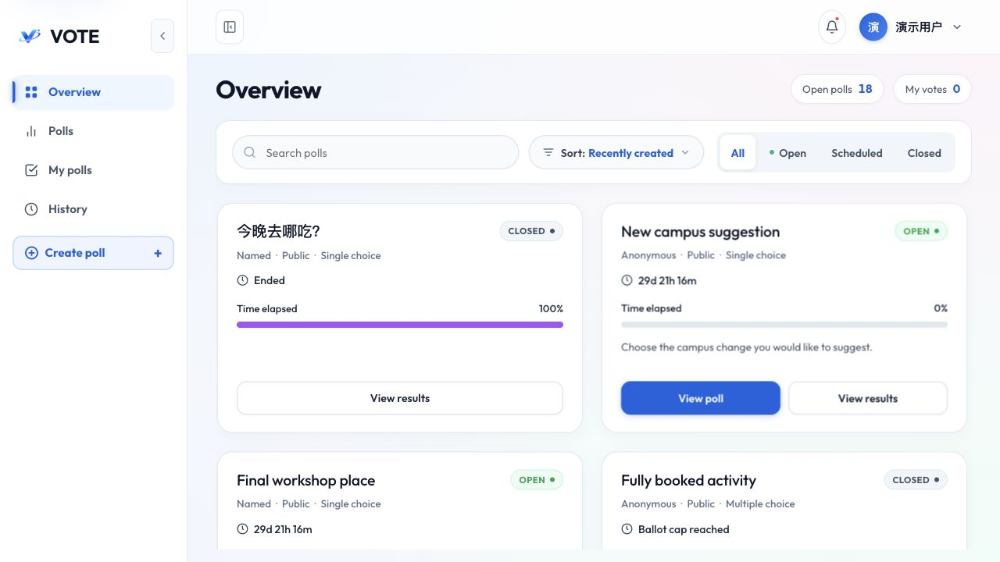
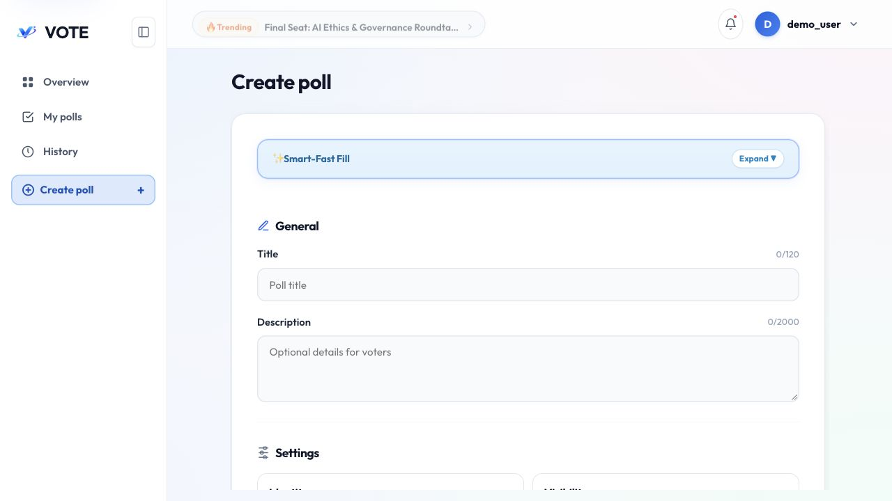

# VoteNow · 在线投票系统

* VoteNow 是 HKMU COMP8500SEF 第 60 组课程项目，采用 React 前端与 Python 后端分离架构，支持创建、分享、参与投票和查看结果。适用于课堂活动、团队讨论和小组决策演示。

  普通注册用户即可创建投票，访客可直接参与公开匿名投票；私有投票通过分享链接和访问密码进入。项目提供 Docker Compose 启动方式，也支持前后端独立开发。

## 页面预览

* 投票概览：查看投票状态、剩余时间和选票进度。

  

* 创建投票：填写主题、选项、时间及参与规则，可选择启用智能文字填写。

  

* 投票结果：分别统计选票数量与选择次数，展示选项票数和占比。

  

  截图采集于 2026-10-29，展示本地演示数据。

## 主要功能

* 投票创建与参与

  | 功能 | 说明 |
  | --- | --- |
  | 账户与访客 | 支持注册、登录和访客浏览，创建投票需要登录 |
  | 记名／匿名 | 记名投票要求登录；匿名投票使用浏览器凭据防重复 |
  | 公开／私有 | 公开投票进入公共列表；私有投票通过链接与密码访问 |
  | 单选／多选 | 至少三个有效选项时可启用多选 |
  | 选票上限 | 可设置整场选票提交次数上限，达到上限后关闭 |
  | 时间安排 | 支持开始、结束时间及发布后的排期状态 |
  | 结果可见性 | 创建者可决定参与者能否在投票进行中查看汇总 |
  | 分享 | 支持分享链接、邀请文本与二维码 |
  | 创建者工作区 | 管理自己的草稿、发布投票、关闭投票和查看汇总 |
  | 投票历史 | 登录用户可查看自己的记名投票记录 |
  | 管理员 | 查看全部投票及结果，并查询审计事件 |
  | 智能填写（可选） | 从一段文字提取标题、选项及明确给出的部分设置，填入表单后可继续编辑 |

## 快速启动

* 推荐使用 Docker Compose。准备好 Git、Docker 与 Compose 插件，在仓库根目录执行以下步骤。

  1. 首次配置时复制环境模板；已有 `.env` 时不要覆盖。

     ```bash
     cp .env.example .env
     ```

  2. 编辑 `.env`。设置数据库密码、演示账户密码、私有演示投票密码及匿名凭据密钥。模板中的值仅供本地课程演示；`.env` 不应提交到仓库。

     本机 Docker 模式下保留以下访问地址：

     ```dotenv
     PUBLIC_BASE_URL=http://localhost:8188
     ALLOWED_ORIGINS=["http://localhost:8188"]
     COOKIE_SECURE=false
     ```

     `ALLOWED_ORIGINS` 必须是 JSON 数组。`DATABASE_URL` 和 `TEST_DATABASE_URL` 中的用户名、密码需与 PostgreSQL 配置一致，尤其是在后续使用本机开发模式时。

  3. 构建并启动数据库、后端和前端服务。

     ```bash
     docker compose up -d --build
     ```

  4. 查看服务状态，然后访问 [http://localhost:8188](http://localhost:8188)。

     ```bash
     docker compose ps
     docker compose logs --tail=100 backend
     ```

     首次启动会执行数据库迁移、创建缺失的演示账户；启用初始化投票时，还会补齐固定投票数据。数据库健康检查通过不代表后端迁移已经完成，页面暂不可用时可通过后端日志确认启动状态。

* 演示账户

  | 用户名 | 用途 | 密码来源 |
  | --- | --- | --- |
  | `admin` | 管理员，查看全部投票与审计记录 | `DEMO_ADMIN_PASSWORD` |
  | `demo_user` | 普通创建者，拥有初始化投票 | `DEMO_USER_PASSWORD` |
  | `demo_voter` | 普通参与者，用于体验记名投票 | `DEMO_VOTER_PASSWORD` |

  密码以自己 `.env` 中的设置为准。初始化不会重置已有账户密码；修改环境变量后重启，也不会自动修改数据库中的旧密码。初始化私有投票的密码来自 `DEMO_POLL_PASSWORD`。

* 常用维护命令

  ```bash
  # 停止服务，保留数据库卷
  docker compose down

  # 修改代码或依赖后重新构建
  docker compose up -d --build

  # 查看后端运行日志
  docker compose logs -f backend
  ```

  全栈 Compose 与下文的独立数据库模式均使用宿主机 5432 端口，不应同时启动两套数据库服务。

## 使用流程与投票规则

* 详细的操作步骤、角色权限、结果导出和常见问题请看 [详细使用文档](docs/technical/user-guide.md)。

* 基本流程

  1. 注册或登录，在 Create poll 中填写标题、选项和时间。
  2. 选择记名／匿名、公开／私有、选票上限及结果可见性；私有投票设置访问密码。
  3. 保存草稿，核对后在创建者工作区发布。
  4. 分享链接；私有投票同时向参与者提供访问密码。
  5. 参与者在有效时间内提交选票；创建者按需查看结果或提前关闭投票。

* 关键规则

  | 规则 | 当前行为 |
  | --- | --- |
  | 记名投票 | 同一账号在同一场投票中只能提交一次；当前不支持每天重新投一次 |
  | 匿名投票 | 同一浏览器凭据在同一场投票中只能提交一次；清除凭据或更换浏览器可能再次参与，不能保证严格的一人一票 |
  | 多选 | 一次可选多个选项，但仍只算一份选票，不代表可重复提交 |
  | 选票上限 | 限制整场接收的选票数量，而不是所有选项的得票总和；达到上限的提交与关闭在同一事务中处理 |
  | 结果百分比 | 按各选项获得的选择次数占总选择次数计算；多选场景的总选择次数可大于选票数 |
  | 进行中查看结果 | 表示允许参与者打开汇总结果，不等于页面持续自动刷新 |
  | 创建者与管理员 | 按权限查看汇总；管理员监督页面不赋予修改他人投票的能力 |
  | 私有投票 | 不进入公共列表，分享链接不包含访问密码；解锁私有投票不能代替记名投票所需的登录 |
  | 历史记录 | 展示记名投票记录，不展示匿名投票记录 |
  | 时间 | 创建页面按香港时间填写，发布后按时间窗口和关闭状态决定是否可投票 |

## 初始化投票与数据保存

* 详细的数据表用途、字段、完整建表语句和 ER 图请看 [数据库设计文档](docs/technical/database-design.md)。

* 默认 Compose 配置启用固定投票初始化，共 38 场，覆盖身份方式、可见性、选票限额、单／多选、结果可见性和不同生命周期状态。

  这些投票由普通账户创建，保存在数据库中，按普通投票规则使用。公共场次与其他公开投票一起展示，私有场次通过分享链接访问；Overview 不另设“示例投票”分区。

  初始化只补齐缺失的固定场次，不覆盖已有标题、密码、时间、选票、分享码或关闭状态。重建镜像不会重置已投满或已关闭的投票，自然到期的投票也不会自动重新开放。设置 `DEMO_POLLS_ENABLED=false` 可停止启动时补齐固定投票，但不会删除已有数据。

* 数据生命周期

  | 操作 | 数据是否保留 |
  | --- | --- |
  | `docker compose up -d --build` | 保留现有数据库卷 |
  | `docker compose restart` | 保留 |
  | `docker compose down` 后再次启动 | 保留 |
  | `docker compose down -v` | 删除该 Compose 项目的数据库卷及其数据 |

  删除卷后再次启动只能重建初始化基线，不能恢复之前的投票记录。需要保留的数据应单独备份。以上说明针对根目录全栈 Compose；独立数据库配置使用 `db/data/` 绑定目录，两种模式不自动共享数据。

* 可选：手动新增一轮四场投票，不修改已有场次。该命令每次都会新增数据，不属于普通启动必需步骤。

  ```bash
  docker compose exec backend /app/backend/.venv/bin/python -m src.main.python.cli new-demo-round
  ```

## 技术栈与目录

* 技术组成

  | 层级 | 技术 |
  | --- | --- |
  | 前端 | React 19、TypeScript、Vite 8、React Router |
  | 后端 | Python 3.12、FastAPI、Pydantic |
  | 数据访问 | SQLAlchemy 2、Psycopg、Alembic |
  | 数据库 | PostgreSQL 17 |
  | 部署 | Docker Compose、Nginx |
  | 可选文字识别 | OpenAI Python SDK，支持配置兼容服务地址 |
  | 测试与检查 | Pytest、Ruff、Vitest、Testing Library、ESLint、TypeScript |

  前端的路由、组件和状态设计请看 [前端设计文档](docs/technical/frontend-design.md)；后端的模块、鉴权和事务设计请看 [后端设计文档](docs/technical/backend-design.md)。

* 主要目录

  ```text
  .
  ├── frontend/                 # React 前端
  │   └── src/
  │       ├── pages/            # 页面
  │       ├── features/         # 投票、账户、创建者等功能
  │       ├── layouts/          # 导航与公共布局
  │       ├── i18n/             # 界面语言
  │       └── lib/              # API 类型与公共工具
  ├── backend/                  # Python 后端
  │   ├── src/main/python/
  │   │   ├── api/              # 路由与依赖
  │   │   ├── algorithms/       # 业务逻辑
  │   │   ├── fileds/           # 请求、响应和上下文模型
  │   │   ├── database/         # 数据模型与数据库访问
  │   │   ├── config/           # 配置
  │   │   └── external_services/ # 外部服务调用
  │   └── tests/                # 后端测试
  ├── db/                       # 独立开发与测试数据库配置
  ├── deploy/                   # Nginx 部署配置
  ├── docs/                     # 项目文档与页面截图
  ├── compose.yml               # 全栈启动配置
  └── .env.example              # 环境变量模板
  ```

  `fileds` 沿用当前代码中的目录名称。`references/` 是本地参考资料目录，不参与应用运行或正常启动。

## 本地开发

* 环境准备：Python 3.12、uv，以及与 Vite 8 兼容的 Node.js 22.12+ 和 npm。Docker 构建使用 Node.js 22。先准备根目录 `.env`，再切换以下配置：

  ```dotenv
  PUBLIC_BASE_URL=http://localhost:5173
  ALLOWED_ORIGINS=["http://localhost:5173"]
  VITE_API_PROXY=http://127.0.0.1:8000
  ```

  将 `DATABASE_URL` 设置为宿主机的 PostgreSQL 连接地址，主机 `127.0.0.1`、端口 `5432`；用户名、密码、库名与 `POSTGRES_USER`、`POSTGRES_PASSWORD`、`POSTGRES_DB` 一致。模板中的 `change-me` 不会自动替换为数据库密码，需自行更新。密码包含 URL 特殊字符时需要编码。

* 在仓库根目录启动开发数据库：

  ```bash
  docker compose --env-file .env -f db/compose.yml up -d --wait postgres
  ```

* 在一个终端启动后端：

  ```bash
  cd backend
  uv sync --frozen
  uv run python -m alembic upgrade head
  uv run python -m src.main.python.cli seed-demo
  uv run python -m src.main.python.cli ensure-demo-polls
  uv run python -m uvicorn src.main.python.main:create_app --factory --host 127.0.0.1 --port 8000 --no-access-log
  ```

  `ensure-demo-polls` 仅在初始化开关启用时补齐投票；不需要演示数据时可以跳过。后端从根目录 `.env` 读取应用配置。

* 在另一个终端启动前端：

  ```bash
  cd frontend
  npm ci
  npm run dev -- --host localhost
  ```

  访问 [http://localhost:5173](http://localhost:5173)。前端通过 Vite 将 `/api` 请求代理到后端。接口交互文档可在本机后端运行时访问 [http://127.0.0.1:8000/docs](http://127.0.0.1:8000/docs)；全栈 Compose 默认未向宿主机开放后端 8000 端口。

  全部后端接口、请求响应字段、鉴权方式和错误码请看 [后端接口文档](docs/technical/backend-api.md)。

## 可选智能填写与配置

* 智能填写默认关闭，不配置模型服务也可以使用普通创建和投票功能。启用时，在根目录 `.env` 中设置：

  | 配置 | 用途 |
  | --- | --- |
  | `POLL_TEXT_PARSE_ENABLED` | 设置为 `true` 启用 |
  | `OPENAI_API_KEY` | 模型服务凭据，仅供后端使用 |
  | `POLL_TEXT_PARSE_MODEL` | 所使用的模型名称 |
  | `OPENAI_BASE_URL` | 可选的兼容服务地址，留空使用 SDK 默认地址 |
  | `POLL_TEXT_PARSE_TIMEOUT_SECONDS` | 请求超时，允许 1–60 秒 |
  | `POLL_TEXT_PARSE_RESPONSE_FORMAT` | 根据服务能力选择 `json_schema` 或 `json_object` |
  | `POLL_TEXT_PARSE_STREAM` | 当前识别链路保持 `false` |

  其他模型参数见 [.env.example](.env.example)。修改后重新启动对应后端服务。文字识别只辅助填写，最终以用户检查并保存的表单为准；原文没有明确给出的可选信息由表单默认值处理，不自动发布投票。识别时输入文本会发送到所配置的模型服务。

* 其他常用配置

  | 配置 | 说明 |
  | --- | --- |
  | `SESSION_TTL_HOURS` | 账户会话有效期 |
  | `GUEST_TTL_DAYS` | 访客会话有效期 |
  | `POLL_ACCESS_TTL_MINUTES` | 私有投票访问授权有效期 |
  | `ANON_VOTER_HMAC_KEY` | 匿名防重复标识使用的服务端密钥，已有数据运行期间应保持稳定 |
  | `COOKIE_SECURE` | 本机 HTTP 使用 `false`，HTTPS 部署应配置为 `true` |
  | `PUBLIC_BASE_URL` | 分享链接使用的前端访问地址 |
  | `ALLOWED_ORIGINS` | 浏览器来源白名单，使用 JSON 数组 |

## 测试与检查

* 前端：在 `frontend/` 目录执行。

  ```bash
  npm run typecheck
  npm run lint
  npm run test -- --run
  npm run build
  ```

* 后端：数据库测试会重建或清空专用测试库。先将根目录 `.env` 中的 `TEST_DATABASE_URL` 配置为本机 `127.0.0.1:5433/voting_test`，凭据与数据库配置一致，`TEST_POSTGRES_DB` 保持 `voting_test`。不要指向开发或需保留数据的数据库。

  在仓库根目录启动测试数据库：

  ```bash
  docker compose --env-file .env -f db/compose.yml --profile test up -d --wait postgres-test
  ```

  然后在 `backend/` 目录执行：

  ```bash
  uv sync --frozen
  uv run ruff check .
  uv run --env-file ../.env pytest
  ```

  测试数据库辅助代码读取进程环境变量，因此测试命令显式加载 `.env`。这里提供检查方法，不代表每次代码修改后这些检查都已经通过。

## 项目文档

* 详细技术文档统一存放在 `docs/technical/`，以表格、架构图和代码示例说明当前实现。

  | 文档 | 内容 |
  | --- | --- |
  | [数据库设计](docs/technical/database-design.md) | 全部表用途、字段、DDL、索引、ER 图与迁移 |
  | [前端设计](docs/technical/frontend-design.md) | 页面路由、组件、状态、请求与导出流程 |
  | [后端设计](docs/technical/backend-design.md) | 架构、业务模块、身份权限、生命周期与事务 |
  | [后端接口](docs/technical/backend-api.md) | 全部应用接口合并于一份文件，含字段、示例与错误码 |
  | [详细使用](docs/technical/user-guide.md) | 安装、创建、分享、参与、结果导出、管理与维护 |

  旧协作快照保留在 `docs/coordination/`。开发计划与审查记录分别保存在 `docs/superpowers/plans/` 和 `docs/reviews/`，不作为已完成功能清单；代码修改后也应同步维护上述技术文档。

## 团队与使用范围

* 本项目由 HKMU COMP8500SEF 第 60 组完成，用于课程学习与演示。当前仓库未附独立开源许可证；如需作为开源项目发布，应先由团队确认授权方式并补充许可证文件。团队成员及具体贡献可在确认后补充。
