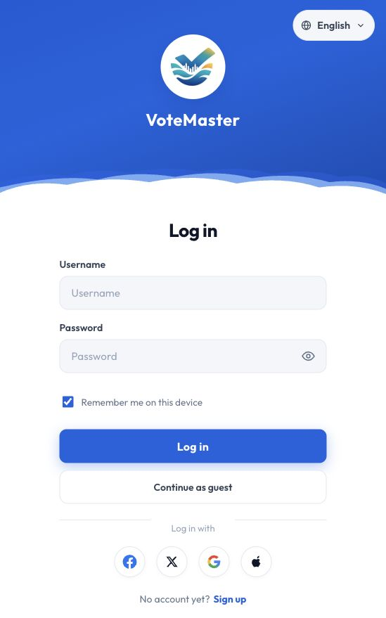
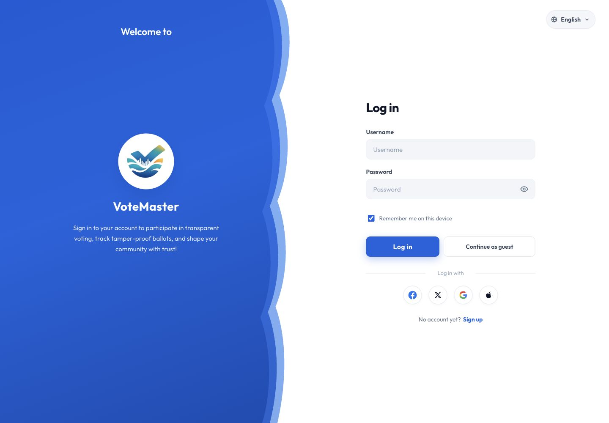
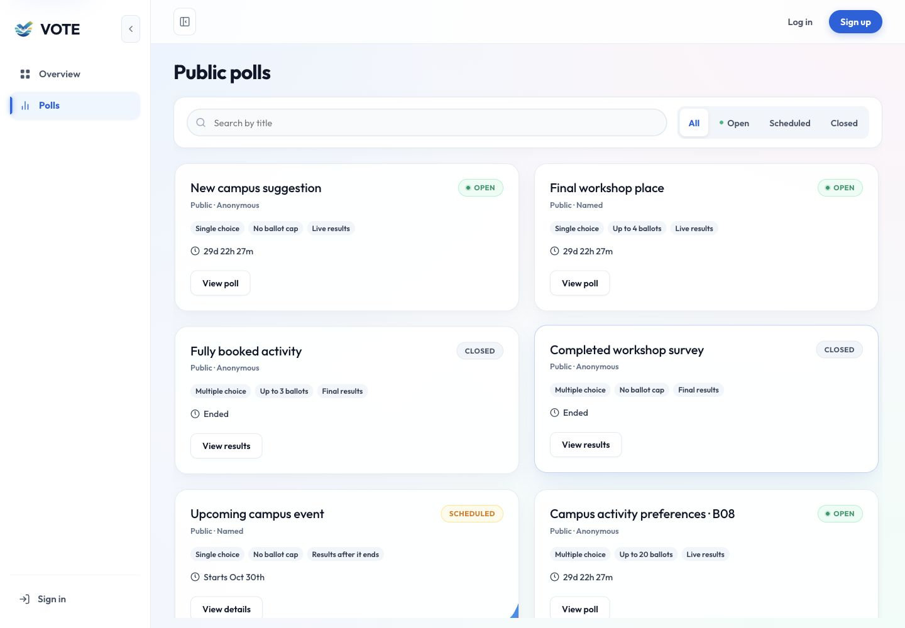
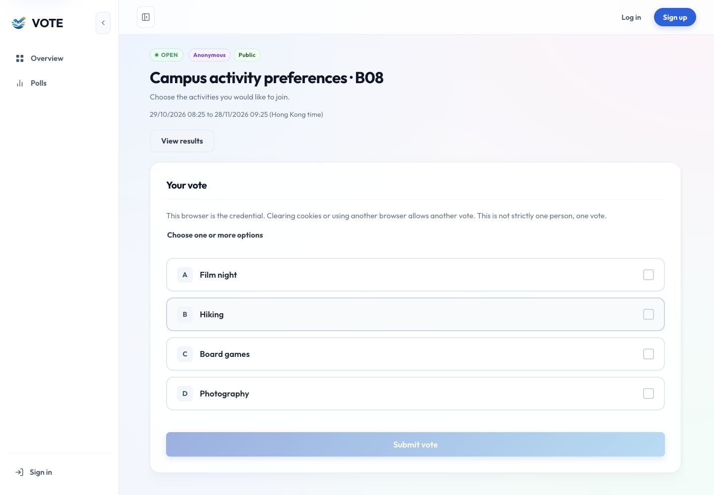
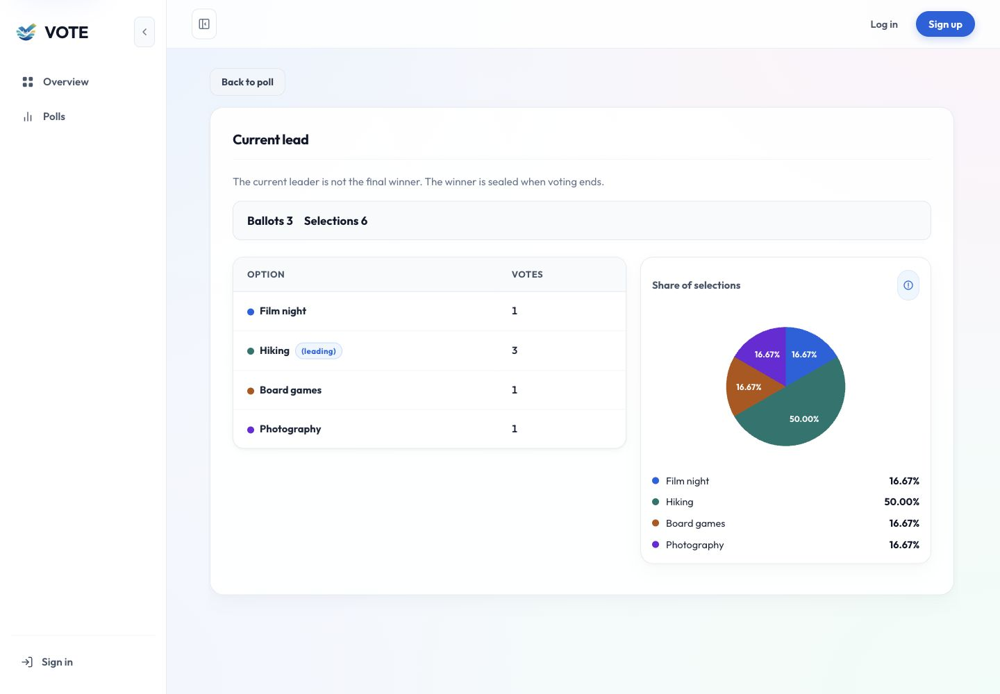
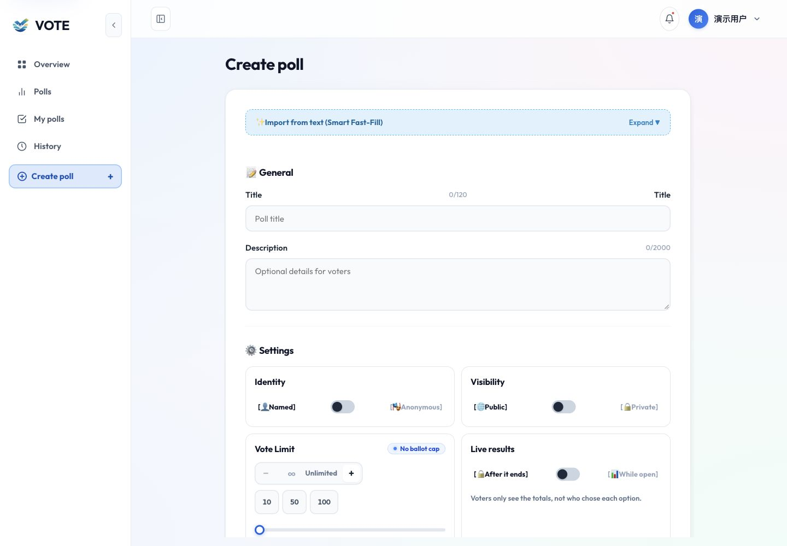
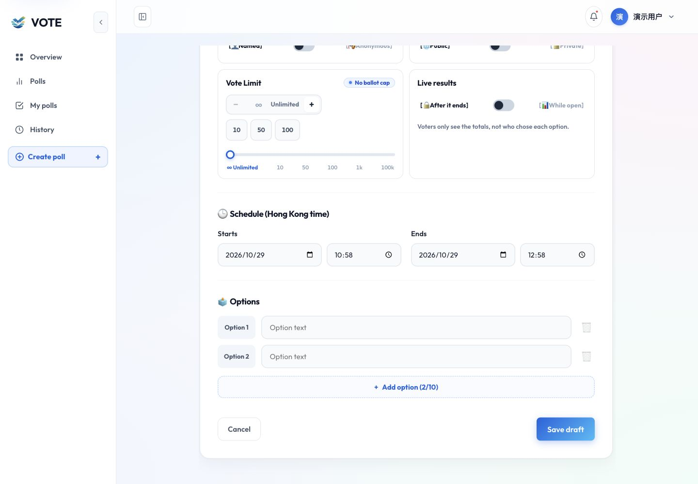
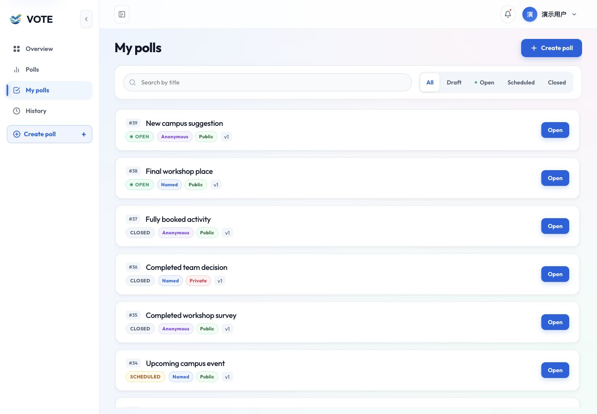
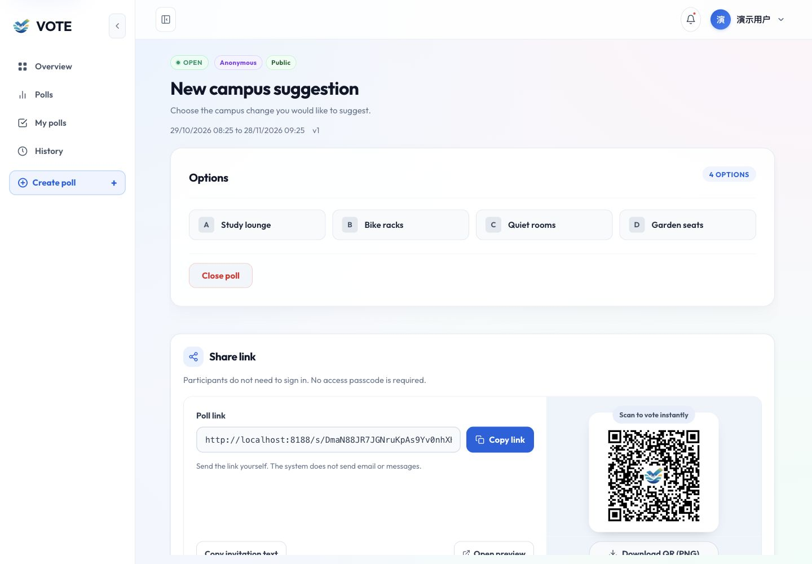

# 前端页面截图分析与布局修改计划

* **当前结论：优先修复 Overview 卡片裁切，再统一表单、结果页和管理页面的信息层级。**

  审查日期：2026-10-29，香港时间。访问对象为本机 `http://localhost:8188` 实际运行页面；依据本次检查保存的 11 张截图及当前源码。不修改产品代码，不提交投票、不创建账户、不保存草稿、不关闭投票。

  **覆盖尚未完成**：已截图 9 类页面，包括登录、注册、公开列表、投票详情、结果、Overview、创建表单、创建者列表／工作区（列表与工作区在下文分别分析）。历史、编辑、私密密码、管理员及错误页尚未获得截图。中断前浏览器自动审批因额度不足失败；续查时同一浏览器标签页可列出，但获取页面返回 `browser.user is unavailable`，无法继续。未换浏览器或绕过审批。未截图的页面只列待验证方案，不宣称已完成视觉审查。

  图片保存在本文件旁的 `assets/2026-10-29-layout/` 并通过相对路径嵌入；需要一起保留或提交。Markdown 本身不包含 JPEG 二进制。截图 01 是默认窄窗口，549×879；截图 02–11 为桌面 1440×1000。不是全部设备的响应式认证。应用有内部滚动容器，fullPage 截图仍只能看到其当前可见内容；创建表单另补了下半屏，不把首屏当整页。

  优先级：P1 影响阅读、主要操作或明确违背已确认需求；P2 影响理解、效率和一致性；P3 视觉精简。以下修改均是待实施计划，截图展示的是修改前现状。

## 页面覆盖与主要发现

* **逐页状态与证据索引。**

  | 序号 | 页面／状态 | 截图 | 当前评价 |
  |---|---|---|---|
  | 1 | 登录 `/login` | 01、02 | 主流程清楚，冗余入口与品牌不一致，P2 |
  | 2 | 注册 `/register` | 03 | 表单完整，条款和未实现入口需调整，P2 |
  | 3 | 公开列表 `/public-polls` | 04 | 卡片完整，标签及长列表密度可改善，P2 |
  | 4 | 多选详情 `/polls/17` | 05 | 选项易操作，说明过长、缺规则摘要，P2 |
  | 5 | 实时结果 `/polls/17/results` | 06 | 数据图表清楚，缺投票标题与更新时间，P2 |
  | 6 | Overview `/overview` | 07 | 卡片被压缩裁切，示例专区违背最新需求，P1 |
  | 7 | 创建 `/my-polls/new` | 08、09 | Title 重复、设置表达冗余，P2 |
  | 8 | 我的投票 `/my-polls` | 10 | 列表可读，技术信息比业务规则突出，P2 |
  | 9 | 创建者工作区 `/my-polls/39` | 11 | 分享模块偏高、结果下沉；下半页尚未截图，P2 |
  | 10 | 历史 `/my-votes` | 待补 | 未完成视觉验证 |
  | 11 | 编辑 `/my-polls/:id/edit` | 待补 | 未完成视觉验证，不能拿新建截图代替 |
  | 12 | 私密密码 `/s/:shareCode/access` | 待补 | 未完成视觉验证 |
  | 13 | 分享入口 `/s/:shareCode` | 待补 | 未完成转跳／错误状态截图 |
  | 14 | 分享结果 `/s/:shareCode/results` | 待补 | 未完成授权状态截图 |
  | 15 | 管理员列表 `/admin/polls` | 待补 | 未登录管理员实拍 |
  | 16 | 管理员详情 `/admin/polls/:id` | 待补 | 未登录管理员实拍 |
  | 17 | 审计 `/admin/audit` | 待补 | 未登录管理员实拍 |
  | 18 | 禁止访问 `/403` | 待补 | 未完成视觉验证 |
  | 19 | 404 页面 | 待补 | 未完成视觉验证 |

  `/` 是重定向入口，无独立布局。尚未验证已投、提交失败、空结果、结束结果、长标题、中文切换、手机虚拟键盘及所有菜单弹层。访问使用访客和 demo_user；登录凭据只用于本地登录，未写入报告或截图。

## 已截图页面分析

* 以下逐页将截图、已确认问题、修改位置与验收条件放在一起。

### 1. 登录

* **截图 01：默认窄窗口；截图 02：桌面。**

  

  

  优点：输入标签独立显示，登录与访客入口清楚，密码可显示／隐藏。桌面左右两栏有明确分工。

  问题 L01（P2）：品牌区占近半屏，含较长介绍；窄屏蓝色品牌区约占首屏三分之一。它延后用户进入表单，不符合只保留必要文字的偏好。L02（P2）：四个社交登录图标暗示可用登录方式，当前 LoginPage 使用 ComingSoonModal；不是完整登录入口。L03（P2）：登录页叫 VoteMaster，登录后导航叫 VOTE，品牌表达不一致。Remember me 也需核对是否有实际会话差异；仅凭截图不能确认。

  修改计划：保留两栏结构，将品牌介绍缩成一句或去掉，窄屏压缩到 120–160px 品牌头；移除尚未实现的社交登录行。统一品牌名，主按钮采用一个稳定色而不是额外强调装饰。核对 remember 值是否进入登录调用；没有功能则移除该控件，不保留虚假选择。涉及 `pages/LoginPage.tsx`、`styles/auth.css`、`layouts/AppLayout.tsx`、i18n。

  验收：390×844 下无需先翻过大块品牌区才能输入；密码显示按钮可键盘操作；登录、访客与注册链接均可见且含义不同。不给未实现的 OAuth 新增后端需求。

### 3. 公开投票列表

* **截图 04：访客公开列表首屏。**

  

  优点：搜索与状态筛选同一行；两列卡片能完整展示标题、身份、规则、时间和按钮。比 Overview 的裁切状态健康。

  问题 P01（P2）：规则小标签字号偏小、淡灰底与次要文字区分有限，需实测对比度。P02（P3）：卡片之间及卡片内部留白较多，首屏只能完整看四张；对 21 场列表扫描效率一般。P03（P2）：访客侧栏 Overview 会要求登录，且同屏顶部 Log in、侧栏 Sign in 表达不统一。两处折叠按钮也增加重复操作。

  修改计划：维持两列，不为塞更多内容改成过窄三列；统一卡片 padding 到约 20–24px，缩短相邻信息块间距，规则字体建议至少 12px。倒计时显示更自然的“Ends in 29 days”，详情提供准确时间，不需要每张卡都突出分钟。统一 Sign in/Log in 文案；访客可优先只呈现能直接访问的导航。折叠入口保留一处。

  验收：长标题两行仍完整，规则可换行但按钮对齐；分页可以滚动到达；320px 不横向溢出。涉及 `PollCard.tsx`、`scheduleLabel.ts`、`styles/polls.css`、`AppLayout.tsx`。

### 4. 投票详情与参与表单

* **截图 05：匿名、多选、公开、有容量限制的投票。**

  

  优点：选项整行可辨识，字母序号和选择框位置稳定；提交按钮位于选项之后，未选时禁用。

  问题 D01（P2）：匿名凭据的整段实现说明占据主要投票区域。D02（P2）：列表显示了票数上限，详情标题区却只有身份、公开性和时间，用户临提交时看不到同等清楚的规则摘要。D03（P2）：投票面板约 1000px 宽，短选项与最右选择框相距很远。顶部 View results 与实际投票目标的主次关系可以更明确。

  修改计划：标题下统一显示单选／多选、上限、实时结果设置；匿名提示缩为“此浏览器可提交一次”，限制说明收进可访问的详情提示，保留事实但不铺满主界面。参与面板建议最大宽 760–880px；结果入口作为标题旁次级操作，不比提交按钮突出。

  验收：不隐藏必要限制；多选计票单位明确是 ballot；选择整行和键盘都可操作，禁用按钮旁可以理解缺少选择的原因。涉及 `PollDetailPage.tsx`、`ParticipationPanel.tsx`、`BallotForm.tsx`。

### 5. 结果

* **截图 06：进行中、多选结果。**

  

  优点：选项票数与占比同时展示，Ballots 3 和 Selections 6 区分了多选统计口径；表格能补充纯颜色图形。

  问题 V01（P2）：页面只有 Current lead，没有投票标题，无法迅速判断是哪场结果。V02（P2）：长句解释“当前领先并非最终赢家”抢占标题之后的第一行；不是每种投票都适合“winner”表达。V03（P2）：界面没有可见的更新时间或刷新动作，无法从截图确认实时性；不据此断言后端数据陈旧。V04（P3）：表格、饼图、图例重复呈现四个选项，图例较高时左侧留下空白。

  修改计划：增加投票标题作为 h1，状态显示“Current results / Final results”；解释缩到状态旁提示。结果增加刷新状态及更新时间，依赖现有接口能力决定由服务端返回还是记录前端成功刷新时间，不混称。默认表格增加百分比列；饼图保持辅助地位，长选项／多选场次可优先使用横向条形图。

  验收：独立打开 URL 也知道投票主题；0 票无 NaN，2／10 个选项均可读；读屏可读取精确数值，不依赖颜色。涉及 `PollResultPage.tsx`、`ResultsPanel.tsx`、共享结果类型（若需要时间字段）。

### 7. 创建投票

* **截图 08：上半屏；截图 09：滚动后的下半屏。**

  

  

  优点：General、Settings、Schedule、Options 有分组；保存操作有明确标签；日期与时区可辨。

  问题 C01（P2）：标题行出现两个 Title，计数落在中间。源码 label 内有重复 `.sr-only` span，当前截图显示其未被正确隐藏。C02（P2）：设置使用方括号、emoji、左右文字按钮加中间 switch，视觉和操作入口重复。C03（P2）：票数上限同时提供减号、输入、加号、预设、滑杆、刻度以及两个无限额表示，占据大量空间。C04（P2）：选项排在时间和设置之后，核心内容需要长距离滚动；初始只有两项时，多选功能的存在不明显。C05（P3）：Import from text (Smart Fast-Fill)、Expand ▼、emoji 和虚线框显得像原型说明。

  修改计划：标题只保留 label 与右侧计数，修正真正的 visually-hidden 工具类或删去重复标签。Identity、Visibility、Results 使用一个分段控件或一个带清晰状态的 switch，不保留三个等价操作。票数上限简化为“Unlimited / Limited”加数字输入，预设最多保留一行，移除滑杆。内容顺序建议标题／描述→选项→设置→时间→保存，文本识别作为顶部可选折叠入口，短标题 Import from text。多选控件始终可发现，两项时禁用并短注“At least 3 options”。

  验收：选择模式、公开性和上限变化不丢值；≥3 选项才能启用多选；私人密码字段出现不撑坏卡片；10 个选项和错误消息不遮挡底部保存。涉及 `PollForm.tsx/.css`、`PollTextImport.tsx`、全局视觉隐藏工具类及 i18n。未点击付费识别接口，展开状态需补拍。

### 8. 我的投票

* **截图 10：创建者列表。**

  

  优点：单行式列表适合管理，标题与状态易比较，创建入口明显。

  问题 M01（P2）：每项有 #ID 和 v1，但缺少更有用的截止时间、选择模式／额度信息。M02（P2）：已关闭项也叫 Open，虽表示打开详情，却与 OPEN 状态容易混淆。M03（P3）：大量蓝色按钮重复强调，和页面顶部 Create poll 争夺注意力。

  修改计划：普通列表移除版本号，ID 仅在需要定位时显示于详情次要信息；追加简短时间／规则摘要。操作统一为 Manage / View，草稿可显示 Edit draft，关闭项显示 View results。行内操作用次级按钮，主要蓝色留给 Create poll。不要把标题改成按钮，也不要让整行点击影响文字选择。

  验收：长标题、私密状态、草稿和关闭状态不挤压操作列；同一个入口文字不同时表示状态。涉及 `MyPollsPage.tsx`、共享标签及列表样式。

### 9. 创建者工作区和分享

* **截图 11：工作区首屏，下半页结果区未完成截图。**

  

  优点：标题、选项、分享链接和二维码都能找到；Close poll 使用危险色，复制链接靠近链接输入框。

  问题 W01（P2）：Close poll 独占选项卡底部，管理动作与选项内容混放；分享区域高度很大，结果数据在首屏之外。W02（P2）：“系统不会发邮件／请自行发送”属于实现说明，可删减。W03（P2）：二维码标题 Scan to vote instantly，但当前链接指向 localhost，手机扫码并不一定能访问该电脑。该结论来自截图中的链接，不是实际扫码测试。W04（P3）：标题区有 v1，无直接帮助。

  修改计划：标题右侧设置管理操作组，关闭放危险次级菜单并保留确认。分享做紧凑两列：链接与复制在左，约 160px 二维码在右，邀请文本／下载等折叠为次级操作；清除多余解释。将结果摘要放在分享之前或使用“Overview / Share / Results”简单切换，避免默认堆成长页。部署文档核对可访问的 PUBLIC_BASE_URL；无法保证跨设备访问时不使用 instantly 文案。

  验收：链接与二维码一致、长链接不会撑宽、键盘可复制、复制反馈简短；仅展示创建者可见密码，默认遮盖。私密分享形态及结果下半屏必须补拍后再定最终尺寸。涉及 `PollWorkspacePage.tsx`、`SharePanel.tsx/.css`、`ResultsPanel.tsx`。

## 未截图页面的补查与修改准备

* **以下仅基于路由／源码结构提出检查点，不是截图结论。**

  | 页面 | 当前可确认结构 | 补拍及拟定修改方向 | 文件 |
  |---|---|---|---|
  | 历史 | 表格列为投票、完整 receipt、提交时间 | 分别拍空态／有记录；长 receipt 采用缩略加复制，窄屏变记录卡；无记录时给可参与投票入口 | MyVotesPage.tsx |
  | 编辑 | 复用 PollForm，需真实草稿 | 拍有内容、校验错误、只读／已发布；沿用创建表单布局，明确保存修改与发布差别 | PollEditPage.tsx |
  | 私密密码 | 窄表单，密码框、显示按钮、错误提示 | 拍初始、错密码、加载；减少固定 36px 内边距对窄屏的挤压，主按钮完整可见 | PollAccessPage.tsx |
  | 分享入口 | 根据授权和身份进入不同状态 | 拍匿名私密、记名未登录、无效链接；保持明确的单一下一步，不泄露私密正文 | ShareEntryPage.tsx |
  | 分享结果 | 复用结果页并处理授权 | 拍密码未授权和成功结果；沿用结果标题／状态改进 | PollResultPage.tsx |
  | 管理员列表 | 表格、状态筛选、创建者 ID | 拍长标题及窄屏；保留管理员所需 ID，其他长字段截断可展开；与 My polls 对齐过滤工具栏 | AdminPollsPage.tsx |
  | 管理员详情 | 管理详情与汇总 | 拍公开、私密及结束状态；保持身份与权限清楚，不与参与投票操作混放 | AdminPollDetailPage.tsx |
  | 审计 | 时间、actor、action、poll、receipt、request ID 六列 | 拍有记录／无记录、筛选、窄屏；宽表限定自身滚动，ID 缩略＋复制，详情可展开 | AdminAuditPage.tsx |
  | 403 | 窄卡片、说明、My polls 返回链接 | 拍访客／普通用户状态；检查返回目标是否再次要求权限 | ForbiddenPage.tsx |
  | 404 | 窄卡片、说明、公开列表入口 | 拍不存在路由，使用简短说明和一致错误图标，避免全页营销式装饰 | NotFoundPage.tsx |

  所有页面再补 390×844 和 768px 检查；登录窄截图为 549px，不能替代手机测试。内层滚动、固定工具栏及底部安全区优先检查。中英文分别检查长标签与日期。

## 改正顺序与验收计划

* **第一阶段：修复可见性与已确认需求，P1。**

  1. 先用当前 Overview 状态建立截图回归基线，移除独立示例区；不删除数据库投票。
  2. 调整主内容滚动责任，修复卡片被压缩，核对 `.poll-card` 与 `.plaza-card` 选择器的实际使用。
  3. 测试只有一套搜索、正常公开筛选、分页，以及宽窄屏卡片按钮可达；原功能测试通过后再次实拍。

* **第二阶段：完成核心参与流程，P2。**

  1. 修复 Title 重复，简化设置与票数上限控件，调整选项顺序和多选入口。
  2. 详情补规则摘要，压缩匿名长说明；结果补投票标题、状态和刷新信息。
  3. 统一我的投票与工作区操作层级，减少版本号、冗余文字和分享模块高度。
  4. 每个组件修改后检查单选／多选、私密、截止、0 票、10 选项和长标题，不只检查理想短文本。

* **第三阶段：补齐管理与响应式，P2/P3。**

  1. 恢复浏览器后，先补齐上表未截图页面，再决定是否需要调整其具体间距，不凭代码猜尺寸。
  2. 登录注册移除未实现入口并统一品牌；审计和历史使用适合窄屏的长 ID 展示。
  3. 统一间距尺度为 8/12/16/24/32px、主内容最大宽和按钮层级；这是建议尺度，不要求所有页面强制同宽。
  4. 真实测量文字对比度、焦点可见性、Tab 顺序及屏幕阅读器标签。截图只能发现风险，不能声明 WCAG 合规。

* **验收方法与交付。**

  前端执行 lint、typecheck、现有测试、build；增加针对 Overview 裁切、重复标签、控件状态和公开列表过滤的有意义回归测试。浏览器覆盖 1440×1000、1280×720、768×1024、390×844、320×568，检查 200% 缩放。主要按钮建议至少 44px 点击高度，窄屏不出现整页横向滚动；宽表只在表容器内部横向滚动。

  完成后按本文件编号增加对应“修复后”截图，不覆盖本次原始证据。验证每张截图为加载完成状态；有内部滚动的页面分别拍首屏和末屏。完整交付仍依赖补齐未截图页面，目前不能将本报告标为全站审查已完成。
