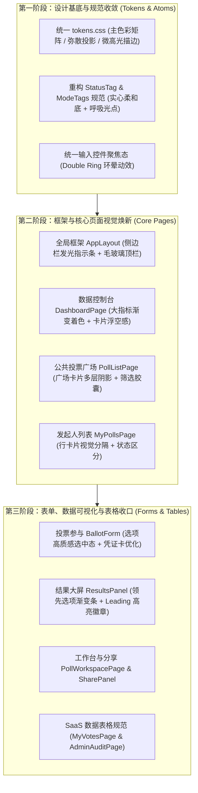

# 全端页面系统性视觉品质升级方案 (Visual Refinement Plan)

> [!IMPORTANT]
> **设计约束与升级原则**
> - **布局零改动**：绝对不变更现有的任何 HTML 骨架、页面栅格、侧边栏架构、滚动分层与业务功能逻辑。
> - **视觉全协同**：消除色彩与边框硬编码，建立统一的现代高质感 SaaS 视觉语言（Linear / Stripe 级质感）。
> - **渐进式演进**：分 3 阶段低风险平滑交付，确保每步皆可即时预览与单元测试全绿。

---

## 一、系统架构与演进路线

---

## 二、基础设计系统升级 (Design Tokens)

在 `tokens.css` 中对现有规范进行沉淀与升级，统一全站引用：

### 1. 色彩与语义矩阵 (Palette Harmony)
- **品牌主色 (Brand Cobalt)**：
  - 常规：`--color-primary: #1363df`
  - 悬浮：`--color-primary-hover: #0f52ba`
  - 浅底：`--color-primary-light: #eff6ff`
  - 微光：`--color-primary-glow: rgba(19, 99, 223, 0.16)`
- **文字与层次 (Text Hierarchy)**：
  - 大标题/重点：`--color-title: #0f172a` (Slate 900)
  - 正文：`--color-body: #334155` (Slate 700)
  - 说明/次级：`--color-muted: #64748b` (Slate 500)
- **边框与玻璃 (Borders & Glass)**：
  - 通用边框：`--card-border: rgba(226, 232, 240, 0.8)`
  - 聚焦/悬停微光：`--card-border-focus: rgba(19, 99, 223, 0.35)`
  - 毛玻璃背景：`--glass-surface: rgba(255, 255, 255, 0.85)`

### 2. 弥散光感阴影体系 (Soft Elevation)
替换现有的单层灰色生硬投影：
- **`--shadow-xs` (按钮/小标签)**：`0 1px 2px rgba(15, 23, 42, 0.05)`
- **`--shadow-card` (默认卡片)**：`0 1px 3px rgba(15, 23, 42, 0.04), 0 6px 16px -2px rgba(15, 23, 42, 0.05)`
- **`--shadow-card-hover` (卡片悬浮)**：`0 12px 28px -6px rgba(19, 99, 223, 0.12), 0 4px 10px -2px rgba(15, 23, 42, 0.04)`
- **`--shadow-popover` (弹窗与浮层)**：`0 20px 40px -12px rgba(15, 23, 42, 0.16)`

### 3. 微排版与数据数字 (Typography & Tabular Data)
- **数字跳动抑制**：全站涉及票数、百分比、时间戳、ID 标签的文字加入 `font-variant-numeric: tabular-nums`。
- **标题字间距收敛**：大标题统一增加 `letter-spacing: -0.025em;`，呈现更为紧凑精致的现代感。

---

## 三、各模块视觉升级细节清单

### 1. 全局框架与导航 (AppLayout & Sidebar)
- **侧边栏 (Sidebar)**：
  - 选中项（Active Nav）：背景采用极浅蓝白渐变，左边缘增加 3px 钴蓝发光条（`border-left: 3px solid #1363df`），图标同步呈现品牌色。
  - 折叠/展开按键：增加平滑的 Hover 缩放与微亮光晕。
- **顶栏用户区 (Header & AuthLocaleMenu)**：
  - 用户头像药丸容器：增加白色半透明微光边框与平滑悬停效果。
  - 语言切换与下拉菜单：升级为无边框毛玻璃悬浮卡片（`backdrop-filter: blur(16px)`）。

### 2. 控制台数据看板 (DashboardPage)
- **大指标统计卡 (Stats Cards)**：
  - 核心数字升级为深钴蓝微渐变填充，视觉重量增强。
  - 图标容器改为浅蓝/浅绿光晕圆角底衬。
  - 顶部“进行中”状态药丸（`dashboard-live-pill`）使用翡翠绿呼吸光点。
- **快速操作按钮组**：增加主次按钮间的对比层次与上浮交互反馈。

### 3. 公共投票广场 (PollListPage & PollCard)
- **筛选与搜索条 (Filter Card)**：
  - 输入框聚焦增加双层环光（`box-shadow: 0 0 0 4px rgba(19, 99, 223, 0.12)`）。
  - Tab 状态切换采用深色高对比度紧凑滑块，与创建页风格统一。
- **投票卡片 (PollCard)**：
  - 卡片圆角统一为 `16px`，增加悬停时 `translateY(-2px)` 与钴蓝弥散光晕。
  - 底部操作按钮从生硬方块改为圆角饱满的微光按键。

### 4. 发起人投票管理列表 (MyPollsPage)
- **行级卡片 (my-poll-row-card)**：
  - 左侧增加精巧的 `#ID` 浅灰圆角胶囊底衬。
  - 状态标签升级：草稿（柔紫）、进行中（翡翠绿 + 呼吸点）、预热中（暖橙）、已关闭（沉稳灰）。
  - 强化主次操作区：编辑草稿（次级线框按钮）与进入工作台（主色填充按钮）层次分明。

### 5. 投票创建与编辑 (PollForm & PollTextImport)
- **区块卡片标题 (Section Headings)**：
  - 标题 Emoji（📝、⏰、🗳️）增加浅蓝半透明微圆角底衬，让卡片层次更鲜明。
- **选项区域交互**：
  - 保持已实现的“3项才显示胶囊”与“1秒脉冲闪烁”，对所有输入框应用统一的微光 Focus 规范。
- **底部操作栏**：
  - 增加顶部平滑渐隐遮罩（Fade Mask），滚动内容在操作栏后穿透时更具质感。

### 6. 投票参与表单 (BallotForm & ParticipationPanel)
- **选项选择行 (Options Selection)**：
  - 未选中态：白底柔灰微边框，Hover 时浅天蓝高亮；
  - 选中态：应用清爽的浅蓝底色（`#eff6ff`）+ 钴蓝加粗描边 + 高亮发光对勾。
- **安全与身份提示条**：
  - 实名投票提示增加微蓝光盾牌，匿名投票提示采用安全翡翠绿微徽章。
- **投票凭据收据卡 (Vote Receipt Card)**：
  - 凭据哈希码（Hash Receipt）使用专用等宽字体（Monospace）并在专属浅灰卡片中展示，一键复制提供平滑的 Toast/反馈动效。

### 7. 投票结果数据可视化 (ResultsPanel)
- **结果进度条 (Progress Bars)**：
  - 领先选项（Top Choice / Winner）：进度条赋予柔和渐变色（`linear-gradient(90deg, #1363df, #3b82f6)`），右侧展示“领先”徽章。
  - 其余选项：保持低饱和度柔和灰色条，通过对比直观突显投票态势。
- **精度提示浮层 (Rounding Note)**：
  - 升级为更紧凑的 Tooltip 浮层，带浅灰发光描边。

### 8. 发起人工作台与分享 (PollWorkspacePage & SharePanel)
- **生命周期状态条**：
  - 顶部状态横幅根据生命周期阶段呈现对应的温和情绪底色。
- **分享链接与二维码面板 (SharePanel)**：
  - 链接输入框与复制按键无缝平滑衔接；二维码增加带有柔光阴影的白底卡托。

### 9. 数据表格全站规范 (MyVotesPage, AdminPollsPage & AdminAuditPage)
- **现代 SaaS 表格规范 (Saas Table System)**：
  - 表头（Thead）：微浅灰底色（`#f8fafc`），大写紧凑微字体，带微弱分割线。
  - 单元格（Td）：行高统一规范为 `48px`，文字垂直居中。
  - 交互反馈：行悬停（Row Hover）呈现平滑浅灰底色（`#f8fafc`），操作按钮更轻巧。

---

## 四、实施计划与验证策略

| 阶段 | 交付范围 | 涉及核心文件 | 验收标准 |
| :--- | :--- | :--- | :--- |
| **Phase 1** | 设计基底与通用原子规范 | `tokens.css`, `StatusTag.tsx`, `global.css` | 全局色彩变量收敛，阴影与标签视觉统一，单元测试全通过 |
| **Phase 2** | 框架、看板与广场列表 | `AppLayout.css`, `dashboard.css`, `polls.css` | 侧边栏/顶栏/看板卡片/广场流/发起人行卡片质感提升 |
| **Phase 3** | 表单、数据结果与后台表格 | `BallotForm.tsx`, `ResultsPanel.tsx`, `views.css` | 选项选中态爽脆，结果进度条层次分明，表格整齐精致 |

---

## 五、下一步行动

本计划现已完整归档。待您确认后，即可启动 **Phase 1（基础设计规范与通用组件焕新）** 的落地实施。

