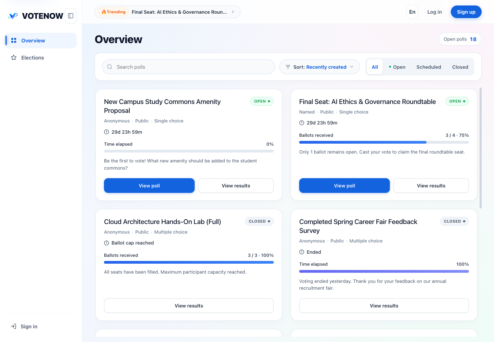
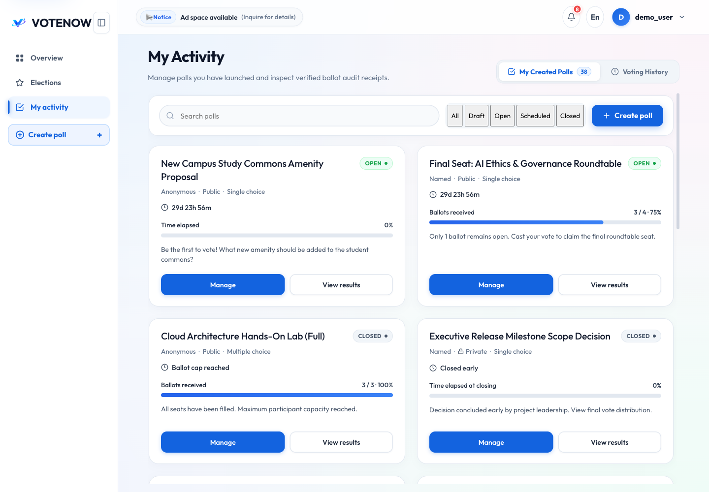
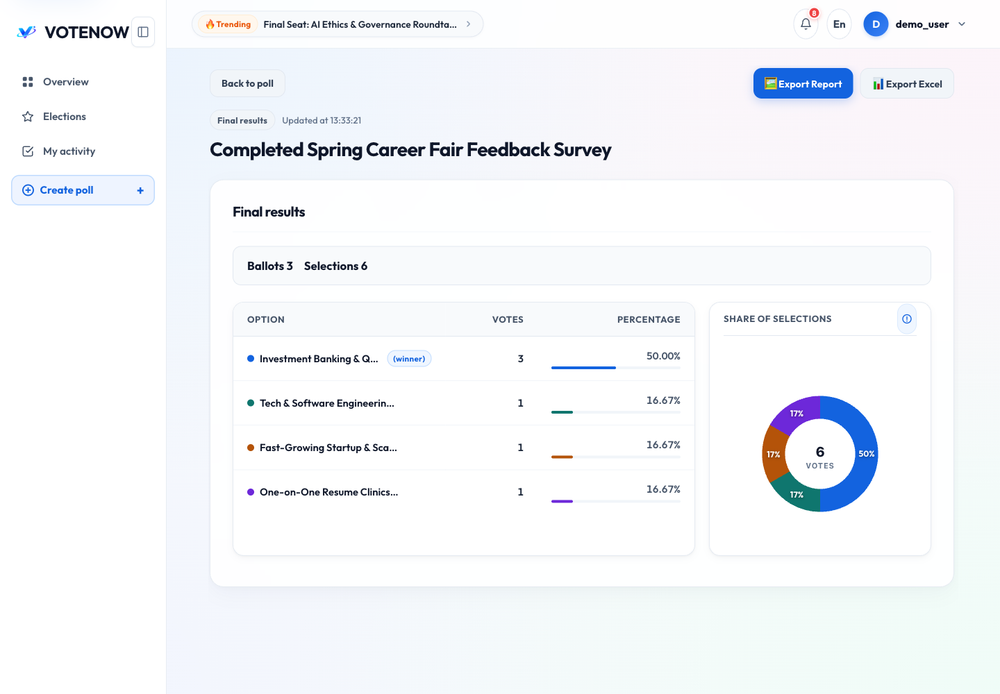
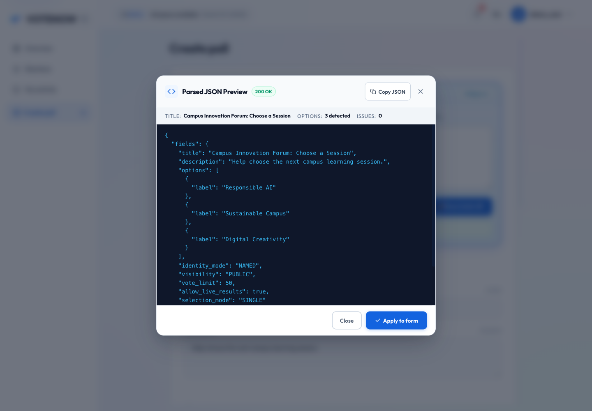
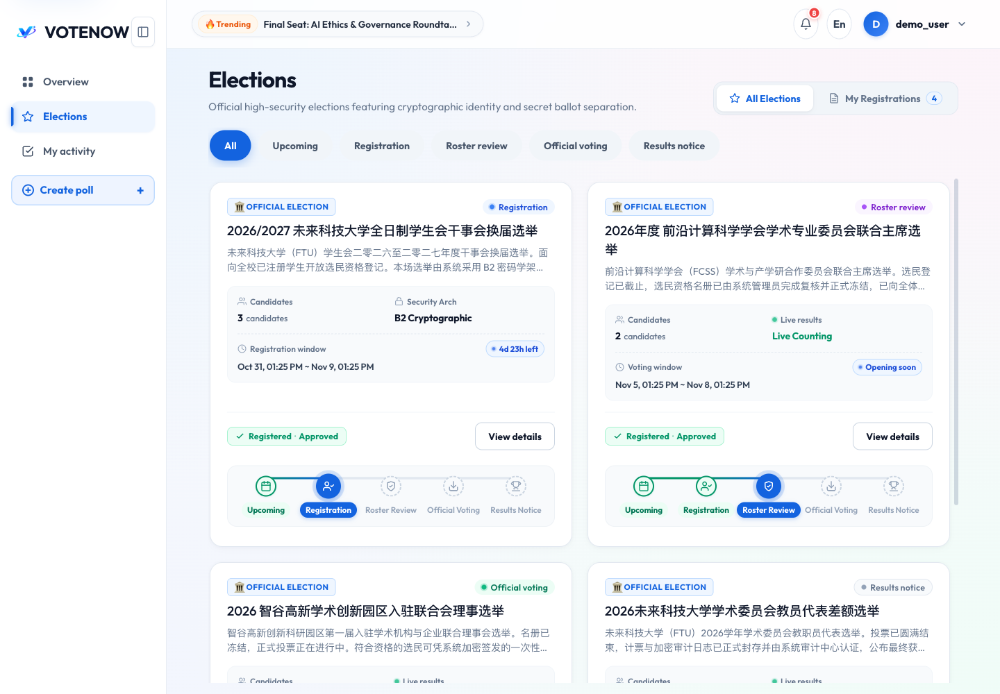
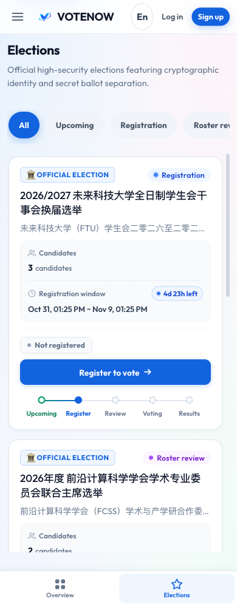
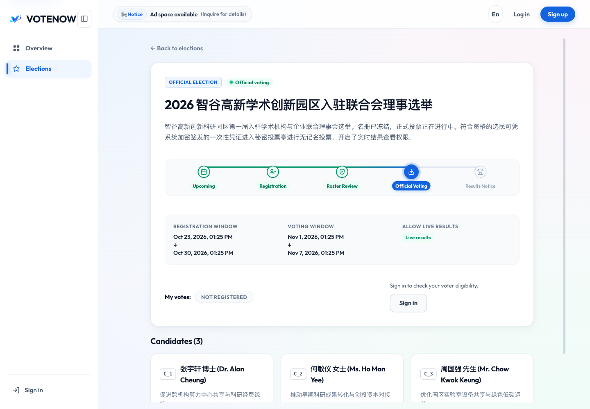
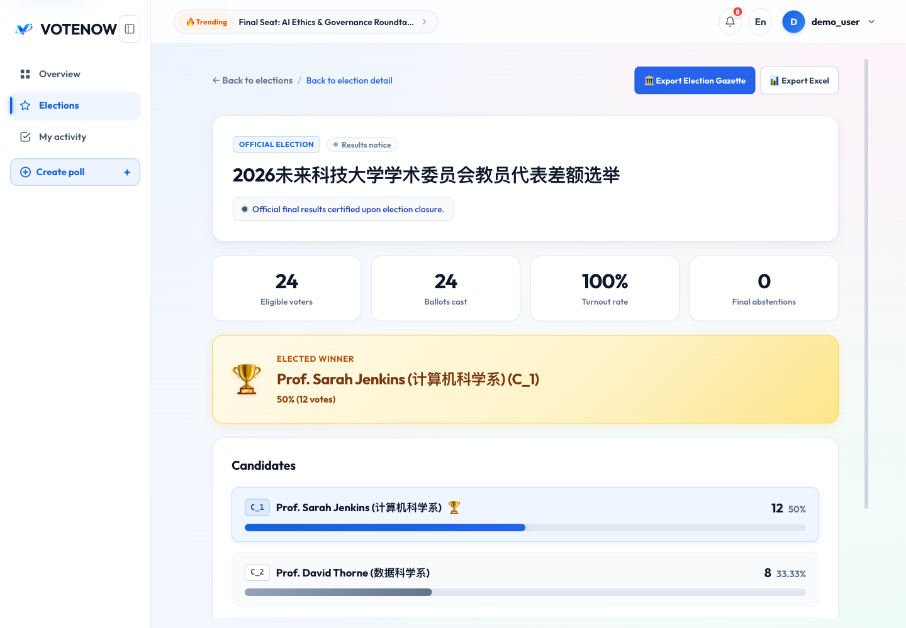

# VoteNow 前端设计

* **范围**：当前 React 前端；核对日期 2026-11-04。按实际路由与组件编写，不将开发计划当作已实现功能。

  [后端接口](backend-api.md) · [后端设计](backend-design.md) · [详细使用](user-guide.md)

## 架构与数据流

* 前端分层

  ```mermaid
  flowchart TB
    Entry[main.tsx / App] --> Providers[LocaleProvider / Ant Design / AuthProvider / GuestProvider]
    Providers --> Router[AppRouter]
    Router --> Layout[AppLayout 桌面侧栏 / 手机导航]
    Layout --> Pages[pages 页面编排]
    Pages --> Features[features 业务组件与 hooks]
    Features --> Client[lib/http.ts 统一请求]
    Client --> API[同源 /api/v1]
    API --> View[类型化数据 / 业务错误]
    View --> Features
    Features --> Export[浏览器 Canvas / XLSX 导出]
  ```

* 层级职责

  | 目录／文件 | 职责 | 关键约束 |
  | --- | --- | --- |
  | `app/router.tsx` | URL 与页面绑定 | RequireAuth 控制登录／管理员页面 |
  | `app/providers.tsx` | 语言、Ant Design 主题、账户、访客上下文 | 账户与访客状态分开 |
  | `layouts/AppLayout.*` | 顶栏（通知下拉、语言与账户）、侧栏、手机导航 | 布局不决定服务端权限 |
  | `pages/` | 加载数据、路由参数、组合业务组件 | 不直接访问数据库 |
  | `features/notifications/` | 通知中心与下拉面板；初次加载、窗口聚焦和每 30 秒重新查询 | 已读状态按账户保存在浏览器；不是服务端推送 |
  | `features/*/api.ts` | 按业务封装端点 | 统一经 apiClient 调用 |
  | `lib/http.ts` | JSON 信封、Cookie、CSRF、重试和错误分类 | 写请求不自动重试 |
  | `lib/api-types.ts` | TypeScript 接口类型 | 与后端模型同步 |
  | `i18n/` | 英文、简体中文、繁体中文文案和错误翻译 | voting_locale 保存语言；业务判断使用 code |
  | `styles/` | 全局 token、认证页、列表、投票和视图样式 | 组件局部 CSS 与全局样式共同生效 |

## 路由与页面

* 所有当前路由

  | 路径 | 页面／行为 | 前端访问限制 |
  | --- | --- | --- |
  | `/` | 重定向 `/login` | 无 |
  | `/login` | LoginPage | 无 |
  | `/register` | RegisterPage | 无 |
  | `/overview` | DashboardPage，公共投票概览 | 可访客访问 |
  | `/public-polls` | 兼容旧链接，重定向 `/overview` | 无 |
  | `/polls/:id` | PollDetailPage | 内部根据投票规则判定 |
  | `/polls/:id/results` | PollResultPage | 后端校验结果访问资格 |
  | `/s/:shareCode` | ShareEntryPage | 分享入口与访问状态 |
  | `/s/:shareCode/access` | PollAccessPage | 密码授权 |
  | `/s/:shareCode/results` | PollResultPage | 先解析分享码，再读取结果 |
  | `/my-activity` | MyActivityPage，Created / Voted 标签 | 登录；`?tab=voted` 选择参与记录 |
  | `/my-polls` | MyPollsPage | 登录 |
  | `/my-polls/new` | PollEditPage 创建模式 | 登录 |
  | `/my-polls/:id` | PollWorkspacePage | 登录；服务端校验创建者 |
  | `/my-polls/:id/edit` | PollEditPage 编辑模式 | 登录；仅自己的草稿可写 |
  | `/my-votes` | MyVotesPage | 登录 |
  | `/admin/polls` | AdminPollsPage | ADMIN |
  | `/admin/polls/:id` | AdminPollDetailPage | ADMIN |
  | `/admin/audit` | AdminAuditPage | ADMIN |
  | `/elections` | ElectionsPage，公开选举列表与阶段筛选 | 可访客访问；登录后附带个人状态 |
  | `/elections/:id` | ElectionDetailPage，选举与候选人详情 | 可访客访问 |
  | `/elections/:id/register` | ElectionRegisterPage，选民登记 | 登录 |
  | `/elections/:id/vote` | ElectionBallotPage，秘密选票 | 登录；后端校验资格与阶段 |
  | `/elections/:id/results` | ElectionResultPage，按权限显示结果 | 后端校验结果权限 |
  | `/elections/:id/result` | ElectionResultPage，兼容单数结果地址 | 同上 |
  | `/my-election-registrations` | 重定向 `/elections?view=my_registrations` | 目标页按登录状态展示本人登记 |
  | `/admin/elections` | AdminElectionsPage，全部选举 | ADMIN |
  | `/admin/elections/new` | AdminElectionCreatePage，创建选举 | ADMIN |
  | `/admin/elections/:id` | AdminElectionDetailPage，发布／冻结／关闭 | ADMIN |
  | `/admin/elections/:id/registrations` | AdminElectionRegistrationsPage，资格复核 | ADMIN |
  | `/403` | ForbiddenPage | 无 |
  | `*` | NotFoundPage | 无 |

  My Activity 是主要导航入口，旧 `/my-polls`、`/my-votes` 独立页面仍可访问。Elections 通过 `view=my_registrations` 展示“我的登记”，当前一次读取前 50 条，未提供该视图的翻页控件。`MyElectionRegistrationsPage`、`PollListPage`、`DemoPollSection` 等源码存在不代表当前路由使用它们。页面可达与数据可读是两层不同的权限判断。

## 核心组件与状态

* 组件边界

  | 组件／模块 | 输入／职责 | 输出／行为 |
  | --- | --- | --- |
  | PollCard | 投票摘要 | 状态、时间、进度条与详情／结果入口；当前桌面为两列，手机为单列 |
  | PollHeroHeader | 标题、描述、状态、时间、可选版本 | 详情与管理页公共头部 |
  | PollForm | 创建／编辑模式、初始值 | 完整草稿字段；前端校验后提交 |
  | PollTextImport | 用户粘贴文字 | 先查能力，再识别；JSON 预览后回填标题、选项、时间及明确给出的规则；模型由服务器配置 |
  | JsonPreviewModal | 智能识别输出 JSON 与草稿字段映射 | 模态框展示原始 JSON，高亮语法与对比字段，确认后填入表单 |
  | PolicyModal | 服务条款与隐私政策 | 注册页模态框展示中英服务规范与条款占位说明 |
  | usePollAccess | pollId 或 shareCode | 详情、门禁状态、重新加载、提交未知态 |
  | ParticipationPanel | 访问状态与结果链接 | 登录、密码、可投、已投等分支 |
  | BallotForm / ConfirmVoteModal | 选项与选择模式 | 原生左对齐选项指示器与选中高亮光晕，提交前弹窗确认 |
  | SharePanel | 创建者分享信息 | 复制链接、密码、邀请文本、二维码 |
  | ResultsPanel | PollResults | Donut 甜甜圈环形占比图（居中显示总票数）与单项微进度条 |
  | DangerCloseModal | 投票提前结束二次确认 | 警示色双重确认弹窗，明确提示操作不可逆 |
  | NotificationDropdown | 用户消息与系统公告 | 铃铛徽标、全部／未读筛选、单条或全部已读及清空当前列表；点击通知跳转业务页 |
  | ElectionCard / ElectionPhaseBadge | 选举摘要与计算阶段 | 候选人数、登记／投票时间、个人登记与已投状态 |
  | ElectionLifecycleTimeline | 统一五阶段进度线 | 卡片 compact 模式在手机保留五个短标题；卡片操作区位于进度线之前 |
  | ElectionDetailPage | 详情、个人资格与操作提示 | 投票阶段按访客、待审、拒绝、未登记解释不可投原因；访客登录链接携带 next 返回地址 |
  | ElectionRegisterPage | 证件登记表 | 先查询已有登记；已有记录时展示状态而不重复提交 |
  | ElectionBallotPage | 候选人单选与确认 | 二次确认；成功后复制随机 UUID 回执 |
  | ElectionResultPage | 规模与候选人结果 | 根据后端返回决定实时／最终结果，不在前端绕过权限 |
  | AdminElectionCreatePage | 选举、登记窗口、实时结果、胜出票数门槛和候选人 | 校验四段时间顺序和至少两名候选人；门槛可留空 |
  | AdminElectionDetailPage | 管理动作 | 发布、冻结名册、提前关闭；当前没有独立编辑路由 |
  | AdminElectionRegistrationsPage | 状态筛选与审核 | 仅 NEEDS_REVIEW 可批准／拒绝；冻结后锁定审核 |
  | ShareCardModal / generate-share-card | 已取得的最终结果 | 浏览器生成 PNG 卡片 |
  | export-excel | 已取得的结果与可选详情 | XLSX 概况与结果明细，无额外导出 API |

* 状态分工

  | 状态 | 保存／恢复位置 | 失效处理 |
  | --- | --- | --- |
  | 账户身份 | AuthProvider；GET /auth/me 恢复 | 清除账户 CSRF，要求重新登录 |
  | 访客凭据 | HttpOnly Cookie；GuestProvider 通过 /guest/context 恢复 CSRF | 到期时更新访客状态 |
  | 两类 CSRF | 内存中的独立 auth / guest 槽位 | 不互相替代 |
  | 表单字段 | PollForm 本地 React state | 保存成功后以服务端结果为准 |
  | 列表过滤与分页 | 对应页面 state（管理与审计含300ms防抖） | 变更过滤条件后防抖重新请求 |
  | 通知状态 | useNotifications 从投票／选举接口生成，本地按账户保存已读 ID | 初次加载、窗口聚焦、30 秒轮询；清空当前列表后，下次查询可能重建已读通知 |
  | 隐藏参与记录 | 按用户名分隔的 localStorage 回执列表 | 仅过滤本地显示；没有删除选票或服务器记录的 API |
  | 语言 | LocaleProvider；localStorage 的 voting_locale | en / zh / zh-TW；没有保存值时默认英文 |
  | 参与状态 | usePollAccess + 后端 has_voted / receipt | 提交不确定时重新读取，禁止自动重投 |
  | 结果数据 | PollResultPage 请求结果 | 进行中提供手动刷新；非持续自动推送 |
  | 选举上下文状态 | election detail 的 phase、can_register、can_vote、can_view_results、next_action | 每次关键操作后重新读取服务端状态 |
  | 选民登记 | my_registration_status / user_registration_status | 页面先查已有记录，避免重复显示登记表 |
  | 选举通知 | useNotifications 从当前选举状态生成 | 顶栏下拉与未读状态沿用通知中心 |

* 参与状态流转

  ```mermaid
  flowchart LR
    Loading[access_loading] --> Failed[access_failed]
    Loading --> Login[login_required]
    Loading --> Password[password_required]
    Login --> Loading
    Password --> Loading
    Loading --> Ready[ready]
    Loading --> Voted[voted]
    Ready --> Confirm[确认选项]
    Confirm --> Voted
    Confirm --> Unknown[submission_unknown]
    Unknown --> Loading
  ```

  `ready` 不等于当前一定能提交：仍须检查详情的 can_vote、时间状态及所选选项。hook 使用 AbortController 和请求序号避免旧请求覆盖新身份／新场次的数据。

## 请求约定与显示规则

* 统一请求行为

  | 场景 | 行为 |
  | --- | --- |
  | GET | 查询参数加入 URL；不发送 JSON body |
  | POST／PATCH | 自动包装 `{data: ...}` |
  | Cookie | `credentials: include` |
  | 账户写操作 | csrfSource=auth |
  | 投票／解锁 | csrfSource=guest |
  | 登录／注册／访客初始化 | csrfSource=none，由浏览器提供 Origin |
  | GET 网络故障或 SERVICE_UNAVAILABLE | 最多额外重试2次，默认间隔200ms |
  | 写请求网络中断 | 不自动重试，结果可能未知 |
  | 非法信封／响应缺数据 | ApiClientError 的 parse 类错误 |

* 选举页面状态。`phase` 是计算出的五阶段，不能代替 `lifecycle`；草稿也映射为 UPCOMING，但仅管理员可读。

  | 后端阶段 | 主要界面动作 |
  | --- | --- |
  | UPCOMING | 已发布但未到登记开始时间；管理员另可看到该阶段的草稿 |
  | REGISTRATION | 登记窗口开放；登录用户可登记，已登记者查看审核状态 |
  | REVIEW | 登记结束；尚未冻结名册，或冻结后未到投票开始时间 |
  | VOTING | 名册已冻结且在投票窗口内；有 ISSUED 凭证的选民可单选提交 |
  | RESULTS | 已关闭或投票时间结束；显示最终票数、投票率、弃权数和胜者／并列结果 |

  `normalizeElectionPhase` 将旧 DRAFT／REGISTRATION_SCHEDULED、REGISTRATION_OPEN、REVIEWING／VOTING_SCHEDULED、VOTING_OPEN、CLOSED 分别归一到五个阶段。新接口响应使用标准值，兼容旧值不代表新增阶段。

* 卡片与结果

  | 条件 | 显示依据 |
  | --- | --- |
  | 有 vote_limit | ballot_count / vote_limit；双色平滑渐变进度条 |
  | 无 vote_limit | 开始至结束时间进度 |
  | SCHEDULED | 开始时间与未开始状态 |
  | CLOSED | 区分 BALLOT_CAP_REACHED、CLOSED_EARLY、ENDED |
  | live results 关闭 | 可展示选票总量，不展示未授权选项统计 |
  | 单选／多选 | 由 selection_mode 决定；原生左对齐选择指示器与选中态光晕轮廓 |
  | 结果图表与占比 | Donut 甜甜圈环形图（65% 内径展示总票数） + 选项行独立微进度条 |
  | 最终结果 | is_final 决定最终状态并高亮胜出者；进行中只表示当前领先 |
  | 导出 | 可见结果可导出 XLSX；独立结果页最终结果提供 PNG 分享入口 |

* 智能填写与显示边界

  | 场景 | 当前处理 |
  | --- | --- |
  | 规则回填 | 原文明示时应用 identity_mode、visibility、vote_limit、allow_live_results；false 也会应用，省略字段保留原值 |
  | 访问密码 | 不由识别结果生成；切到 PUBLIC 清空密码，PRIVATE 需手填 |
  | 选举英文日期 | 按语言使用英文月份；未登记为 Not registered；时间仍为香港时区 |
  | 旧日期工具 | formatHongKong 仍固定 zh-HK，不能声称所有页面日期均已本地化 |
  | 参与历史 | 服务按账户 voter_id 查询；当前包含账户关联的普通匿名票；纯访客匿名票无账户历史 |

* 界面与交互布局

  以下截图更新于 2026-11-04，展示当前组件；智能填写预览使用固定演示响应。完整操作页面见 [使用文档](user-guide.md)。

  

  

  

  

  

  

  

  

  

## 样式、构建与验证

* 工程约定

  | 项目 | 当前实现 |
  | --- | --- |
  | 技术 | React 19、TypeScript、Vite、React Router、Ant Design |
  | 开发代理 | Vite 5173 → VITE_API_PROXY；浏览器请求同源 /api |
  | 发布 | npm run build → dist；Nginx 托管与 SPA fallback |
  | 响应式与布局 | 桌面侧栏与顶栏通知中心、手机底部导航；当前 1440px 截图为两列投票卡片，手机为单列 |
  | 列表与管理体验 | My Activity 统一管理与参与记录；旧 My Polls 状态筛选及列表尾部快捷创建卡片；管理员端 300ms 搜索防抖 |
  | 图片／Excel | 浏览器 Canvas、xlsx；不上传已生成文件 |
  | 类型检查 | npm run typecheck |
  | 风格检查 | npm run lint |
  | 单元与组件测试 | npm run test -- --run |
  | 构建检查 | npm run build |

  代码定位以 `frontend/src/` 为根；接口完整字段见 [后端接口文档](backend-api.md)。本文件描述设计与代码路径，不替代真实浏览器响应式和无障碍测试。
