# VoteNow 详细使用文档

* **适用范围**：本地课程演示、普通参与者、创建者与管理员；核对日期 2026-10-31。以下操作以当前实现为准，页面可切换中英文。

  [数据库设计](database-design.md) · [前端设计](frontend-design.md) · [后端设计](backend-design.md) · [接口文档](backend-api.md)

## 安装与首次启动

* Docker Compose（推荐）

  | 步骤 | 操作 | 检查点 |
  | --- | --- | --- |
  | 1 | 安装并启动 Docker，确认 Compose 插件可用 | `docker compose version` |
  | 2 | 进入项目根目录；首次执行 `cp .env.example .env` | 已有.env不覆盖 |
  | 3 | 设置数据库、演示账户、私有投票密码、匿名密钥与身份指纹密钥 | 不向仓库提交.env |
  | 4 | `docker compose up -d --build` | postgres、backend、web启动 |
  | 5 | `docker compose ps` | 数据库健康，后端完成迁移 |
  | 6 | 访问 `http://localhost:8188` | 打开登录页或进入公共概览 |

  | 配置 | 本机 Docker 使用方式 |
  | --- | --- |
  | PUBLIC_BASE_URL | `http://localhost:8188` |
  | ALLOWED_ORIGINS | `["http://localhost:8188"]`，必须为JSON数组 |
  | COOKIE_SECURE | 本机HTTP为false |
  | POSTGRES_USER / PASSWORD / DB | 数据库初始化凭据与名称 |
  | DATABASE_URL | Compose内覆盖为postgres服务名；本机直跑需自己保持凭据一致 |
  | DEMO_POLLS_ENABLED | 开启时启动补齐固定场次；关闭不删除已有数据 |
  | POLL_TEXT_PARSE_ENABLED | 默认false，不影响普通创建／投票 |
  | IDENTITY_FINGERPRINT_HMAC_KEY | 选民证件指纹密钥；至少 32 字节，且不得与 ANON_VOTER_HMAC_KEY 相同 |

  更详细的环境变量含义见 [README 配置说明](../../README.md#可选智能填写与配置) 和 [.env.example](../../.env.example)。

* 演示账户

  | 用户名 | 用途 | 密码从哪里查看 |
  | --- | --- | --- |
  | admin | 监督全部投票、查看审计 | 自己.env的DEMO_ADMIN_PASSWORD |
  | demo_user | 管理初始化投票 | DEMO_USER_PASSWORD |
  | demo_voter | 以普通账户参与投票 | DEMO_VOTER_PASSWORD |

  初始化只创建缺失账户，不重置已有密码。旧账户密码不会因修改.env自动改变。固定私有场次首次创建时使用 DEMO_POLL_PASSWORD，重启不会覆盖旧场次密码。

## 浏览、注册与登录

* 常见入口

  | 目的 | 路径／操作 | 说明 |
  | --- | --- | --- |
  | 查看公开投票 | Overview，`/overview` | 允许访客；可搜索、排序和筛选状态，桌面大屏采用三列响应式网格 |
  | 旧公共列表地址 | `/public-polls` | 自动转到Overview |
  | 注册 | `/register` | 用户名、显示名、密码；配备密码强度指示条与服务条款弹窗 |
  | 登录 | `/login` | 获得账户会话；Cookie需可用 |
  | 消息通知 | 顶栏铃铛图标 | 查看页面加载时生成的系统、投票和选举提醒；已读状态保存在本浏览器 |
  | 创建投票 | Create poll | 未登录先登录 |
  | 管理自己的投票 | My polls | 包含全部、进行中、草稿、已结束分类计数徽标与快捷创建卡片 |
  | 查看记名记录 | History / My votes | 不包含匿名记录 |
  | 管理员入口 | Supervision、Audit | 仅管理员；手机从账户菜单进入，支持 300ms 搜索自动防抖 |
  | 选举列表 | Elections，`/elections` | 访客可浏览已发布选举；登录后显示个人登记／投票状态 |
  | 我的选举登记 | `/my-election-registrations` | 登录用户查看各场登记及审核结果 |
  | 选举管理 | `/admin/elections` | 仅管理员创建、发布、审核、冻结名册和关闭 |

  | 注册字段与要求 | 规则与辅助反馈 |
  | --- | --- |
  | username | 3–32位字母、数字或下划线；自动规范为小写 |
  | display_name | 去空白后1–50字符 |
  | password | 12–128字符；页面动态展示红/橙/绿强度条与复杂度评估 |
  | 服务条款与隐私政策 | 勾选同意；点击“使用条款与隐私政策”可在弹窗内查阅服务说明 |

* 页面展示

  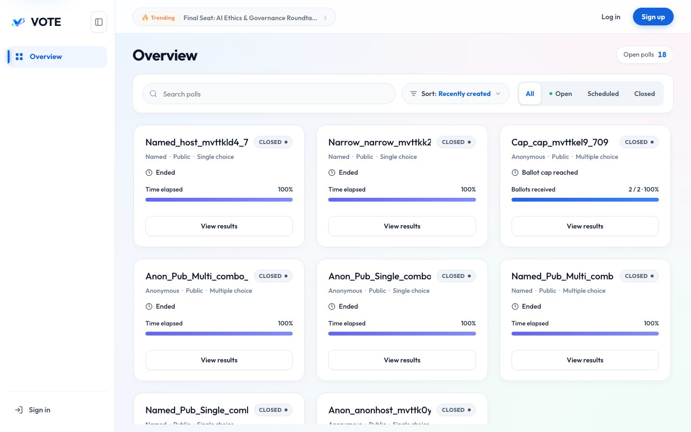

  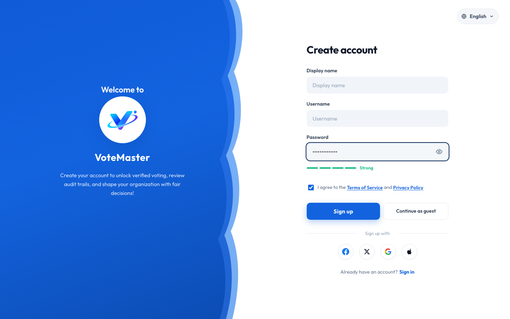

  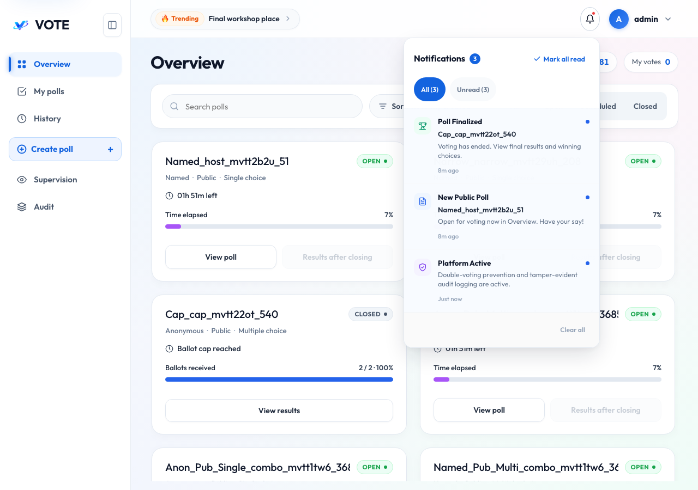

## 创建、编辑与发布

* 创建者操作流程

  ```mermaid
  flowchart LR
    Login[登录] --> Create[填写投票]
    Create --> Draft[保存草稿]
    Draft --> Edit[编辑并核对]
    Edit --> Publish[发布]
    Publish --> Share[分享链接与必要的密码]
    Share --> Results[查看结果]
    Results --> Close[按需提前关闭]
  ```

* 表单字段

  | 字段／设置 | 如何选择 | 规则 |
  | --- | --- | --- |
  | Title | 简短问题或主题 | 1–120字符 |
  | Description | 可选背景与参与说明 | 最多2000字符 |
  | Identity | Named或Anonymous | Named要求参与者登录 |
  | Visibility | Public或Private | Private必须设置访问密码 |
  | Ballot limit / Vote Limit | 不限，或填写数量 | 1–100000份选票；一次多选仍只计一份 |
  | Live results | 进行中可看，或结束后可看 | 不控制创建者与管理员的读取资格 |
  | Starts / Ends | 开始与结束时间 | 香港时间；结束晚于开始；发布时结束不能已经过去 |
  | Options | 填写不同选项 | 2–10项，每项1–200字符 |
  | Single choice / Multiple choice | 一项或多项 | 至少三个有效选项才可多选 |

  页面标签可能随语言不同，核心规则由后端校验。保存草稿也需要完整合法的标题、选项和时间，不是任意空表单都可保存。

* 管理操作

  | 操作 | 可以何时做 | 注意 |
  | --- | --- | --- |
  | 快捷创建 | 任何时候 | My Polls 列表首位提供带加号虚线快捷卡片，一键直达创建页 |
  | 分类查看 | 任何时候 | My Polls 顶部状态标签（全部、进行中、草稿、已关闭）实时显示具体计数 |
  | 编辑草稿 | 自己的DRAFT | 保存是完整替换；若版本冲突，刷新后重新核对 |
  | 发布 | 自己的有效草稿 | 开始时间在未来则排期；发布后内容不能继续修改 |
  | 提前结束 | 自己已发布的投票 | 工作区点击触发红色警示弹窗，二次确认后立即关闭，不可逆且无法重开 |
  | 分享 | 已发布／关闭投票 | 关闭后的链接仍可用于按权限查看结果 |
  | 删除 | 当前无公开删除接口 | 不把关闭当成删除 |

* 界面展示

  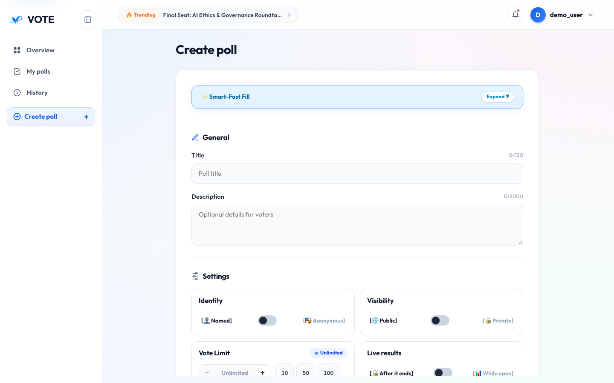

  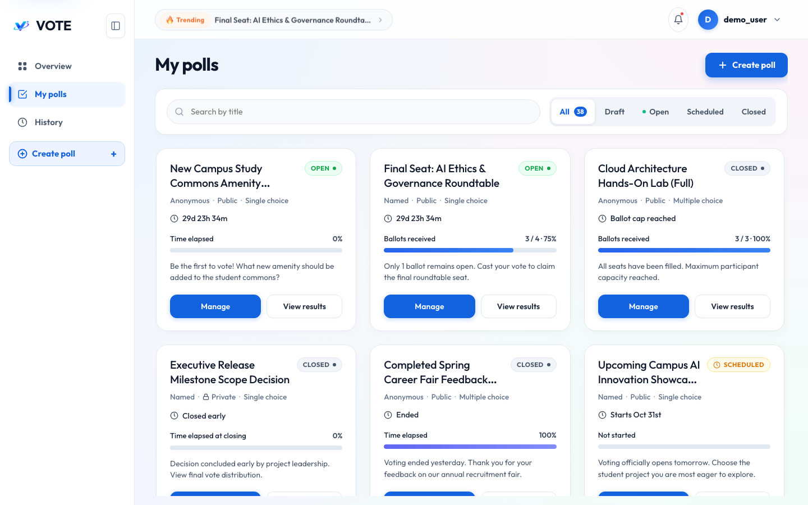

  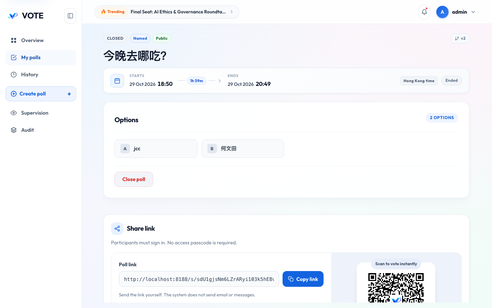

## 智能填写（可选）

* 开启模型服务后，创建页显示智能填写入口。

  | 步骤 | 操作 |
  | --- | --- |
  | 1 | 展开 Smart fill / Smart-Fast Fill 折叠面板 |
  | 2 | 粘贴包含主题、选项和可选截止时间的原文并点击识别 |
  | 3 | 识别完成后可点击 **Preview JSON**，在弹窗中对比原始解析结构与提取字段 |
  | 4 | 核对无误后点击应用（Apply to Form），将候选字段安全填入表单 |
  | 5 | 手动检查并设置匿名／公开、密码、人数上限、结果开关后保存 |

  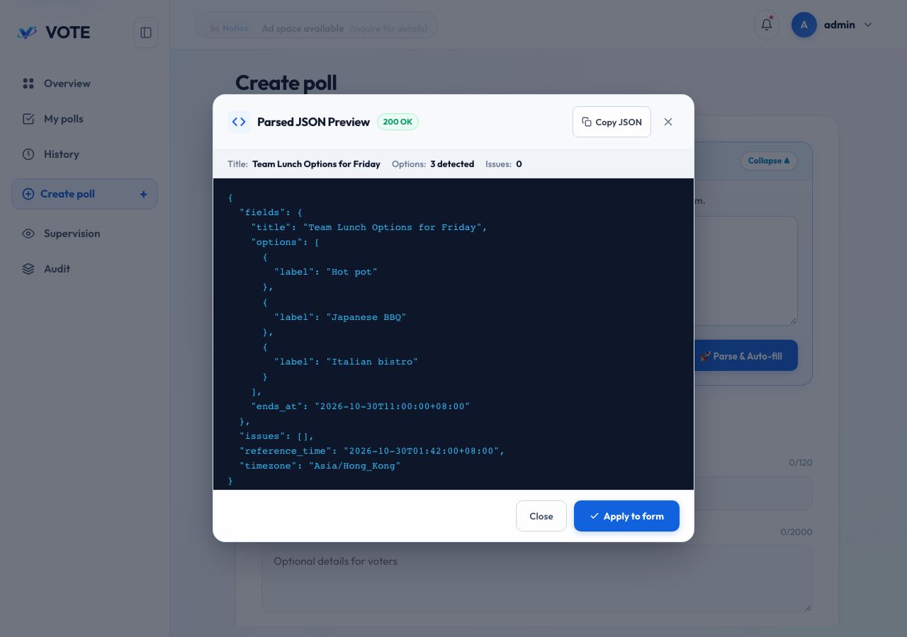

  ```text
  Friday sharing topic:
  Please choose one topic.
  1. React concurrency
  2. PostgreSQL indexes
  3. Frontend testing
  Deadline: 2030-11-01 11:00 Hong Kong time
  ```

  | 情况 | 处理方式 |
  | --- | --- |
  | 没有描述或可靠时间 | 未返回字段沿用表单当前值／默认值，仍需人工检查 |
  | 相对时间有歧义 | 查看问题提示并手动填写 |
  | 选项重复或不足 | 手动修正，不直接发布 |
  | 超时／服务不可用 | 继续手工填写即可 |
  | 频率限制 | 等待后再试，不连续点击 |

  原文会发送到已配置的模型服务；识别不会直接创建或发布投票。只有标题与选项是始终存在的候选键，其值仍可能表示未识别到内容。

## 分享与参与

* 四种组合

  | 投票方式 | 参与者如何进入 | 是否登录 | 是否输入投票密码 |
  | --- | --- | --- | --- |
  | 公开匿名 | Overview或链接 | 不要求 | 否 |
  | 公开记名 | Overview或链接 | 是 | 否 |
  | 私有匿名 | 创建者提供的分享链接 | 不要求 | 是 |
  | 私有记名 | 创建者提供的分享链接 | 是 | 是 |

* 创建者分享

  | 操作 | 用途 |
  | --- | --- |
  | Copy link | 复制投票链接，不包含访问密码 |
  | Copy invitation text | 复制邀请内容后自行发送 |
  | 密码显示／复制 | 将私有投票密码交给获邀参与者；旧记录只有散列时可能无法取回原密码 |
  | Open preview | 检查分享入口 |
  | Download QR | 下载二维码；二维码链接不替代私有访问密码 |

* 参与者投票

  1. 打开页面；私有场次按提示输入密码，记名场次登录。
  2. 检查主题、时间、单／多选方式与是否仍有名额。
  3. 选项采用原生左对齐单选/多选指示器，点击选中时展示高亮外轮廓与发光阴影，防错点防误判。
  4. 选择选项后点击提交并在弹窗二次核对；提交成功后查看选票回执。

  | 规则／状态 | 含义 |
  | --- | --- |
  | 同账号每场一次 | 当前不支持每天重新投一次 |
  | 匿名浏览器每场一次 | 清除凭据／更换浏览器可能再次参与，不能保证严格一人一票 |
  | 私有授权到期 | 重新输入该场密码；不一定需要重新登录账户 |
  | Scheduled | 尚未开始，不能提交 |
  | 达到人数上限 | 接收最后一份选票时关闭 |
  | 网络中断／提交状态未知 | 重新读取投票详情，检查已投状态和回执，不直接重投 |
  | Already voted | 已参与，不能继续提交第二份 |

* 界面展示

  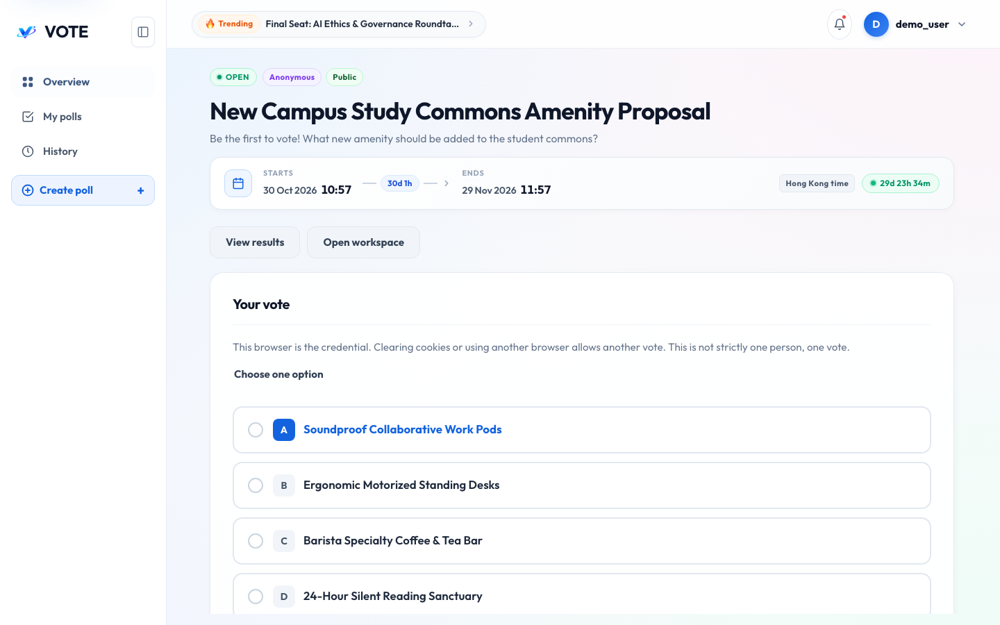

## 查看、刷新与导出结果

* 结果与历史

  | 功能 | 使用说明 |
  | --- | --- |
  | 进行中汇总 | 创建者／管理员可查看；普通参与者还取决于Live results和访问权限 |
  | 结束后汇总 | 已具备该投票访问资格的参与者可查看 |
  | 可视化图表 | Donut 甜甜圈环形图展示各选项比例（中心呈现累计总票数），选项行配平滑微进度条 |
  | 刷新 | 进行中的独立结果页提供手动刷新，不是持续自动推送 |
  | Ballots | 已提交的选票份数 |
  | Selections | 所有选票选中选项的次数之和 |
  | 百分比 | 某项选择次数 / Selections；四舍五入后合计可能略偏离100% |
  | 领先／胜出 | 进行中为当前领先；is_final=true时为最终结果并附带胜出徽标；并列可能有多个最高项 |
  | Excel | 从结果页导出概况和结果明细，浏览器生成.xlsx；进行中导出只是当时快照 |
  | PNG分享 | 独立结果页的最终结果提供分享图片入口；浏览器生成图片后保存／分享 |
  | History | 只展示自己的可访问记名记录；私有记录授权失效后需通过原分享链接重新解锁 |

  当前Excel明细中的最高项标签可能显示 Winner；对于进行中导出应理解为当前领先，不是已定案。导出的文件与图片不会继续受投票页面权限控制，分享前核对内容与接收对象。

* 界面展示

  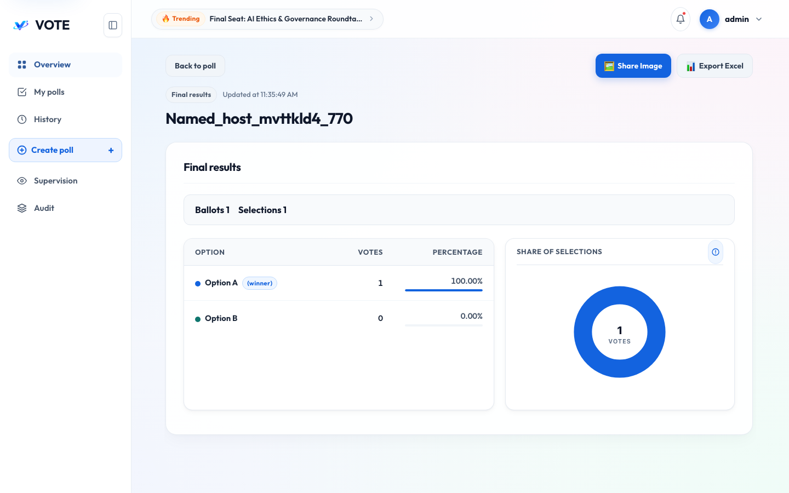

## 选举

* 选民流程

  ```mermaid
  flowchart LR
    Browse[浏览选举] --> Register[登记身份]
    Register --> Review[规则检查／管理员复核]
    Review --> Freeze[名册冻结]
    Freeze --> Vote[投一名候选人]
    Vote --> Receipt[保存回执]
    Receipt --> Result[按规则查看结果]
  ```

  | 步骤 | 操作 | 结果／限制 |
  | --- | --- | --- |
  | 1 | 打开 Elections 并选择选举 | 访客可看已发布摘要和候选人 |
  | 2 | 在 REGISTRATION_OPEN 期间登录并登记 | 填姓名、居民身份证／港澳通行证／学生证、签发方和号码 |
  | 3 | 查看登记状态 | APPROVED 可进入后续名册；NEEDS_REVIEW 等待管理员；REJECTED 不能投票 |
  | 4 | 等待管理员冻结名册 | 冻结后每个 APPROVED 登记得到一个内部凭证；前端不会显示该凭证 |
  | 5 | 在 VOTING_OPEN 期间选择一名候选人并确认 | 每个合资格登记最多提交一次 |
  | 6 | 复制回执 | 回执是随机 UUID，用于确认提交，不包含选择或身份信息 |
  | 7 | 打开结果页 | 可见内容由阶段、实时结果设置、管理员身份及是否已投决定 |

* 身份登记说明

  | 项目 | 当前实现 |
  | --- | --- |
  | 居民身份证 | 检查 18 位形态、日期和 ISO 7064 校验位；校验正确可自动通过 |
  | 港澳通行证 | `C/W/H/M + 8 位数字`可自动通过；其他合理字母数字形式可能转人工复核 |
  | 学生证 | 8–12 位字母数字；识别到受支持的签发方关键字时可自动通过，否则转人工复核 |
  | 规则引擎 | 仅为课程演示的本地格式／校验规则；未接入政府、院校或第三方身份数据库 |
  | 数据保存 | 完整证件号会提交到后端完成本次校验，但不会持久化到数据库；仅保存独立密钥 HMAC-SHA-256 指纹和尾号 |
  | 重复证件 | 同一规范化证件不能绑定到不同账户 |

* 结果显示

  | 状态 | 可见内容 |
  | --- | --- |
  | 进行中且允许实时结果 | 管理员可看规模与候选人票数；已投选民也可看票数；未投或未登录者不可看 |
  | 进行中且不允许实时结果 | 管理员只看登记、合资格、已投和剩余人数；其他人不可看 |
  | 已结束 | 公开最终候选人票数、投票率和系统计算的弃权人数 |
  | 零票／并列 | 零票不产生胜者；最高票相同时展示全部并列候选人 |

* 管理员选举流程

  | 阶段 | 操作 | 关键规则 |
  | --- | --- | --- |
  | DRAFT | 创建选举 | 至少两名候选人；登记开始 < 登记结束 < 投票开始 < 投票结束；可选择是否显示实时票数 |
  | DRAFT | 发布 | 发布后进入按时间计算的阶段；当前前端没有独立选举编辑页 |
  | REGISTRATION_OPEN | 观察登记 | 规则引擎会自动判断可明确处理的证件 |
  | REVIEWING | 筛选并复核 | 对 NEEDS_REVIEW／PENDING 登记选择 APPROVED 或 REJECTED，可写备注 |
  | REVIEWING | 冻结名册 | 所有待处理登记必须先处理；重复点击安全返回既有冻结结果 |
  | VOTING_OPEN | 查看进度或提前关闭 | 提前关闭不可逆；未投凭证计入结束后的弃权人数 |
  | CLOSED | 查看最终结果 | 不支持重新开放 |

## 管理员使用

* 管理员以监督读取为主，页面配备便捷交互。

  | 页面 | 操作 | 边界 |
  | --- | --- | --- |
  | Supervision | 300ms 自动防抖搜索、筛选全部公开与私有投票，支持重置与状态胶囊快速切换 | 包含不同公开性和生命周期 |
  | 投票详情 | 查看选项、规则与汇总 | 通用结果端点不返回草稿汇总 |
  | Audit | 300ms 自动防抖筛选事件、投票 ID、操作者用户名，支持一键清空筛选 | 包含创建、更新、发布、关闭、记名投票与冻结名册 |
  | Elections | 创建并查看所有阶段的选举 | 选举创建仅限管理员 |
  | Election registrations | 按状态筛选并人工复核 | 名册冻结后禁止继续修改审核结果 |
  | 创建者工作区 | 管理管理员自己创建的投票 | 无权修改其他用户的投票 |

  审计不包含匿名逐票事件，也不提供个人选项明细。

* 界面展示

  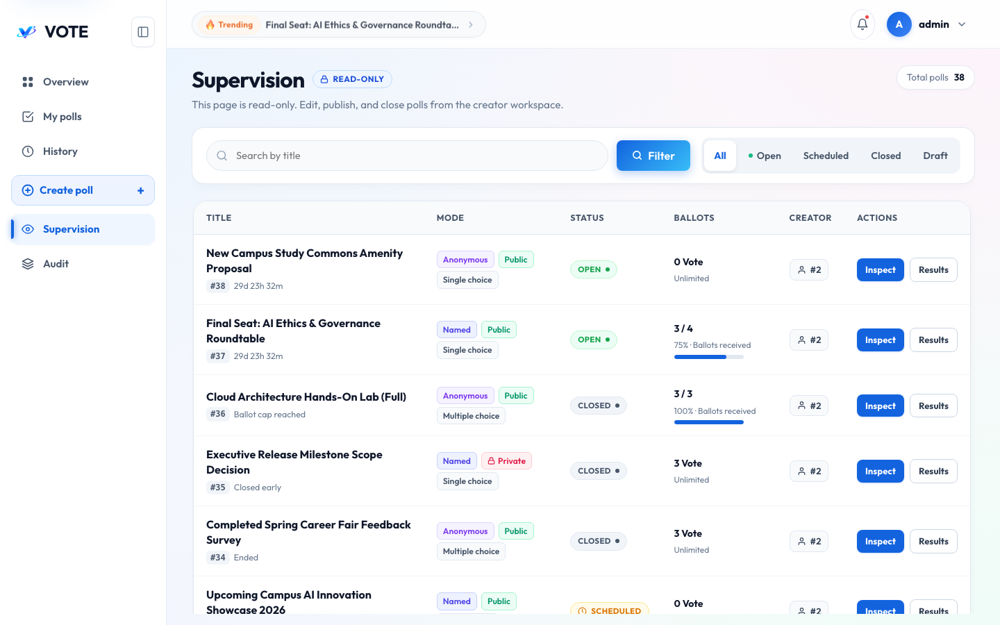

  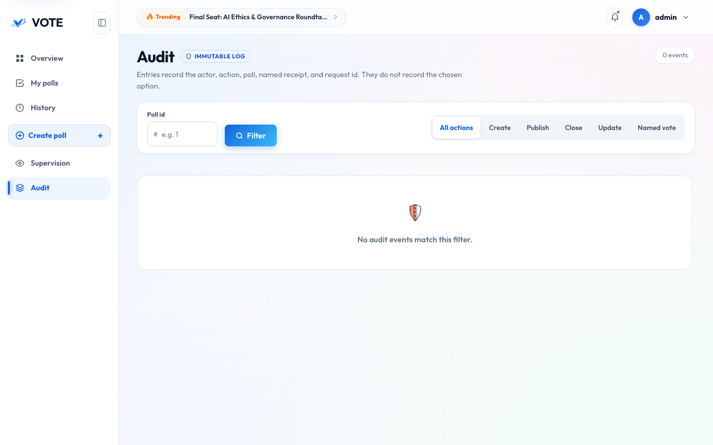

## 本地开发、维护与排错

* 前后端独立运行：完整命令见 [README 本地开发](../../README.md#本地开发)。简要顺序如下。

  | 顺序 | 工作目录 | 操作 |
  | --- | --- | --- |
  | 1 | 根目录 | 将PUBLIC_BASE_URL与ALLOWED_ORIGINS改为localhost:5173；配置本机数据库连接 |
  | 2 | 根目录 | `docker compose --env-file .env -f db/compose.yml up -d --wait postgres` |
  | 3 | backend | `uv sync --frozen`，再执行Alembic迁移 |
  | 4 | backend | 按需seed-demo、ensure-demo-polls，然后启动Uvicorn 8000 |
  | 5 | frontend | `npm ci`、`npm run dev -- --host localhost` |
  | 6 | 浏览器 | 访问localhost:5173 |

* 维护操作

  | 命令／操作 | 结果 |
  | --- | --- |
  | `docker compose up -d --build` | 重建服务，保留数据库卷与已有选票 |
  | `docker compose restart` | 重启；已有投票不会重置 |
  | `docker compose down` | 停止并移除容器，保留命名数据卷 |
  | `docker compose down -v` | 删除该栈数据库卷，无法恢复未备份记录 |
  | 修改演示开关为false | 不再补齐固定投票，不删除现有投票 |
  | 新一轮演示 | 手动执行new-demo-round，每次增加四场，不是重置 |

* 全栈 Compose 逻辑备份：在仓库根目录执行。输出含业务数据与私有访问密码，应作为本地备份保存，不提交Git。

  ```bash
  mkdir -p db/backup
  docker compose exec -T postgres sh -c 'pg_dump -U "$POSTGRES_USER" -d "$POSTGRES_DB" -Fc' > db/backup/votenow.dump
  ```

  上述固定文件名会覆盖同名旧备份；需要保留多份时使用不同文件名。恢复应针对明确的目标库进行，本指南不提供会直接清空当前数据库的一键恢复命令。独立数据库模式需使用对应 `db/compose.yml` 服务，不与全栈卷混用。

* 常见问题

  | 现象 | 检查／处理 |
  | --- | --- |
  | 8188打不开 | Docker是否运行、端口是否被占用、docker compose ps |
  | 前端可开但API报错 | `docker compose logs --tail=100 backend`；检查数据库与迁移 |
  | 本机后端无法连接库 | DATABASE_URL密码是否仍为change-me；与POSTGRES_PASSWORD保持一致 |
  | 403来源校验失败 | PUBLIC_BASE_URL、ALLOWED_ORIGINS与浏览器地址；Cookie及CSRF是否匹配 |
  | 改.env密码仍无法登录 | 初始化不会重置已有账户密码 |
  | 无智能填写入口 | 是否启用且配置齐全；能力接口不等于上游实时健康检查 |
  | 私有投票找不到 | 使用正确分享链接，确认密码授权；普通未授权读取可能返回404 |
  | 结果暂不可见 | 未开始、未启用实时结果或访问资格不满足 |
  | 版本冲突 | 刷新最新草稿后核对修改，不反复提交旧版本 |
  | 重建后投票仍已结束 | 正常持久化；不会因为build重新开放 |

  技术排错时使用 [后端接口文档](backend-api.md) 的业务码表；不要把Cookie、密码或模型密钥粘贴到公开问题报告。
